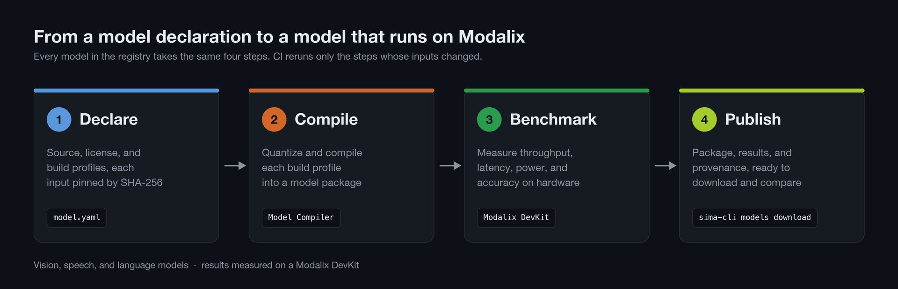

<p align="center">
  
</p>

<h1 align="center">Palette Model Browser by SiMa.ai</h1>

<p align="center">
  The models that run on SiMa.ai Modalix, each one declared in a <code>model.yaml</code>,<br>
  compiled with the Model Compiler, and benchmarked on a Modalix DevKit.
</p>

<p align="center">
  <a href="https://developer.sima.ai/models/">Model Browser</a> ·
  <a href="docs/getting-started.md"><b>Getting Started</b></a> ·
  <a href="docs/adding-a-model.md">Add a Model</a> ·
  <a href="docs/README.md">Documentation</a> ·
  <a href="knowledge/architecture.md">Architecture</a> ·
  <a href="https://github.com/sima-neat/models/issues">Issues</a>
</p>

This repository hosts the models you find in the
[Model Browser](https://developer.sima.ai/models/), each with its measured
performance and accuracy on a Modalix DevKit. You can reproduce every step
behind those numbers on your own machine, from the official model to the
measurements, with the scripts in the model's folder.

> **Start here:** [Getting started](docs/getting-started.md) shows the path
> every model takes and walks through it once with real commands.

Git holds the declaration and the code of each model, not its files. A
declaration pins every input it downloads by URI, byte size, and SHA-256.
Model binaries, datasets, compiled model packages (MPKs), logs, and results
live in object storage.

## Use a Model

List the published models and download one:

```bash
sima-cli models list
sima-cli models download --id resnet_50 --variant w8a8
```

The [Model Browser](https://developer.sima.ai/models/) shows each model with
its measured performance and accuracy. It needs your SiMa Developer Portal
login.

## How a Model Is Built

A **build** is one compile invocation of one build profile of one model. Each
build passes through up to three **stages**:

| Stage | Runs on | Model entry point | Runner script |
| --- | --- | --- | --- |
| compile | Model Compiler | `scripts/compile.py` | `scripts/run_model_compilation.sh` |
| performance | Modalix DevKit | `scripts/performance.py` | `scripts/run_model_performance.sh` |
| accuracy | Modalix DevKit | `scripts/accuracy.py` | `scripts/run_model_accuracy.sh` |

Each stage has a **fingerprint**: a SHA-256 of every input that decides its
result. CI runs a stage only when no published result carries its current
fingerprint, so a change reruns exactly the stages whose inputs it touches.
[What a change reruns](docs/adding-a-model.md#9-know-what-a-change-reruns)
lists the inputs of each fingerprint, and [concepts](docs/concepts.md)
defines these terms.

A model can also compile from a converted ONNX file instead of a pinned
download. See [conversion artifacts](docs/conversion-artifacts.md).

## Add a Model

Install the repository-pinned Model Compiler first. Then install
`model-registry` into it and check a model:

```bash
sima-cli neat install --stg models-utils/model-registry@develop:latest
model-registry --version
model-registry validate models/resnet_50
model-registry fetch models/resnet_50
```

The installer adds `model-registry` to the Model Compiler environment of the
Neat SDK or of a standalone installation, without replacing the compiler's
packages. The package holds only author commands. It cannot publish.

[Add a model](docs/adding-a-model.md) covers the path from `model.yaml` to
review.

## Repository Layout

```text
models/<model-id>/      model.yaml, README.md, hero.png, scripts/, tests/
tools/model_registry/   shared CLI and lifecycle code
scripts/                stage runner scripts and CI helpers
schemas/                JSON Schemas for model.yaml, tests, and reports
artifact-browser/       the Model Browser
docs/                   the public guides: reproduce, add, or update a model
knowledge/              how the tooling, CI, and publication work
```

The [architecture](knowledge/architecture.md) describes every directory.

## Documentation

- [Getting started](docs/getting-started.md): what the repository is for, the
  path every model takes, and how to rebuild a published model and measure it
  on your own DevKit.
- [Documentation](docs/README.md): the contribution path from `model.yaml`
  to review.
- [Architecture](knowledge/architecture.md) and [CI flow](knowledge/ci-flow.md):
  the components, the shared tooling, and what each workflow does.
- [Model taxonomy](docs/model-taxonomy.md): sanctioned category IDs.
