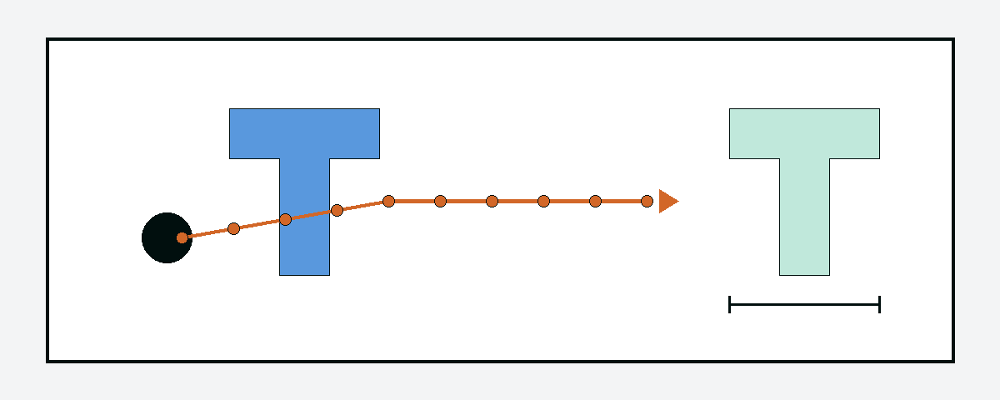

# LeWAM PushT

## Overview

LeWAM PushT predicts actions that move a simulated pusher and T-shaped block toward a goal shown in an image. It takes one or two recent observations and the goal image, then returns ten two-dimensional actions. Three image-encoder components—front, body, and head—produce visual features. A fourth policy component refines the action sequence through eight feedback steps. This package covers direct goal-conditioned action prediction, not gradient-based planning or real-robot control. The application keeps observation history and advances the simulation using the first five predicted actions.

## Inputs and outputs

1. Supply RGB images at 224×224. Normalize channels using means `[0.485, 0.456, 0.406]` and standard deviations `[0.229, 0.224, 0.225]` after scaling bytes to `[0,1]`; do not normalize twice. The front component contains the encoder crop.
2. Run front, body, and head for each valid history image and the goal. Preserve two history positions five simulation actions apart; explicitly mask the missing older observation after reset. For dataset reproduction, use the recorded initial image at step zero and retain it for step-five history. The head returns 192 visual features.
3. Pack `policy_input` as `[1,192,1,34]`: history columns 0–1, goal 2, ten noisy actions 3–12, time 13, horizon 14, and the original attention mask 15–33. Use the supplied conditioning protocol without changing its mask or noise distribution.
4. Read `velocity_padded`, `[1,192,1,10]`. Its first two channels contain velocities; remaining channels must be zero. Perform eight separate CPU updates `actions = actions + velocity / 8` in float32.
5. Multiply the ten action pairs by `[0.2084674835,0.2067486644]`, then add `[-0.0078125652,0.0068606865]`. Execute the first five pairs and replan. There are no class indices or detection decoder.

## Building applications

Run the package with the [Neat Model API](https://developer.sima.ai/software/develop-apps/development-workflow/model). For complete applications, start from the [Neat example apps](https://developer.sima.ai/examples).
