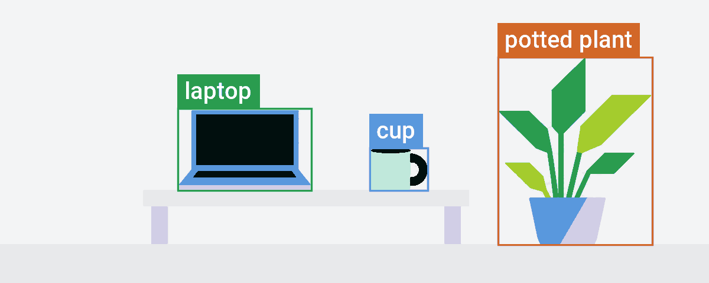
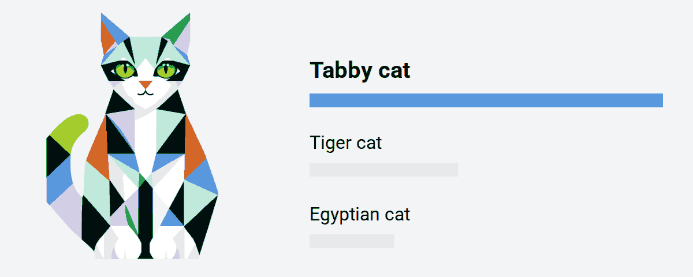

# Geometric comic illustrations

Use this guide for model heroes, explainers, diagrams and comic sequences.
Choose the detail level by the object's size and the information being shown.

## Choose the style

| Style | Use for | Detail | References |
| --- | --- | --- | --- |
| Simplified icons | Informational graphics, scenes with several objects, diagrams and sequences | Flat silhouettes with the fewest shapes needed for recognition and essential features only | [RF-DETR Nano](assets/examples/rf_detr_nano.png) |
| Detailed illustrations | Large focal subjects, single-object heroes, close-ups and explanations of features or defects | More facets and selected facial, structural or diagnostic features; quieter unrelated areas | [ResNet-50](assets/examples/resnet_50.png) |

A hero containing several small objects still uses the simplified style.
Add detail when the subject has enough space and it helps explain something:
a vehicle in a scene needs a simple silhouette; a close-up explaining a wheel
or a defect needs the relevant parts.

## Establish the structure

- Default to a front or flat side view. Use shallow perspective only when needed
  to explain depth or a functional part. Keep connected parts aligned, correctly
  proportioned and consistent in perspective; preserve symmetry where the
  object requires it.
- Define the silhouette and key functional parts first. A laptop needs a
  rectangular screen and a centered base; a cup needs a visible handle. Objects
  must be identifiable without reading their labels.
- Use the fewest shapes needed for recognition. Represent keyboards, grilles
  and similar repeated details as one solid area in simplified icons. Add a
  detail only when it improves recognition at thumbnail size.
- Check the silhouette and functional geometry without labels at a thumbnail
  size such as 300×120 before adding color facets.
- Apply color facets within the established structure. Preserve the outer
  contour, proportions, symmetry and functional openings. Keep rectangular
  screens rectangular and a laptop's screen and base on a shared centerline.

## Shared rules

- Build broad facets from horizontal, vertical and repeated 45-degree diagonals,
  inspired by the supplied SiMa.ai references. Allow circles, arcs and small
  curves where anatomy or mechanical function needs them.
- Use expressive eyes and a contrasting mouth where faces matter.
- Use a muted natural skin tone for each person's face, ears, neck, hands and
  other exposed skin. Keep that tone consistent across the person, with one
  solid fill and black facial features. Put corporate accents in clothing and
  accessories. Do not use white, teal or other brand accents as skin.
- Use crisp, continuous boundaries and solid color regions. Remove speckles,
  grain, stray pixels and edge halos, including artifacts introduced by palette
  remapping. Simplification should preserve a deliberate, finished shape.
- Pair blue/lavender/black, orange/teal/black or green/teal/lime within connected
  planes. Use a few colors per object rather than every accent everywhere.
- Use neutral backgrounds, generous spacing and restrained scenery. No logos,
  wordmarks, photographic textures, lighting effects, gradients, glows or shadows.
  Base illustrations are opaque; segmentation masks are the exception below.

## Colors

Use these ten brand colors for objects, clothing, backgrounds and annotations.
Exposed human skin has the narrow exception below; do not add other colors,
shades or tints.
Background/text combinations follow the supplied brand table; prefer black on
a neutral background for small copy. These are brand pairings, not a blanket
accessibility claim.

| Background | Hex | Permitted text colors |
| --- | --- | --- |
| Gray | `#F3F4F5` | Black, orange, blue, green |
| Gray | `#E8E9EB` | Black, orange, blue, green |
| White | `#FFFFFF` | Black, orange, blue, green |
| Black | `#010F0E` | White, `#F3F4F5`, lavender, teal, lime |
| Orange | `#D26728` | White |
| Lavender | `#D1CEE6` | Black |
| Blue | `#5998DD` | White |
| Teal | `#C0E8DB` | Black |
| Green | `#2A9C4F` | White |
| Lime | `#A4CC2D` | Black |

Use [palette.svg](assets/illustration-guide/palette.svg) for export.
The following three skin tones are an intentional exception limited to exposed
human skin. The brand palette remains the ten colors above; scenes without
people use that ten-color palette.
For this exception, choose one of `#E4B493` (light), `#BC8768`
(medium) or `#8C624D` (deep). Use varied tones across groups of people, keeping
each person's face and hands consistent. Use flat fills without blush,
highlights or extra skin facets. Keep these colors out of clothing, objects,
backgrounds, annotations and text.
The [palette with skin tones](assets/illustration-guide/palette-with-skin.svg)
includes this exception for scenes containing people.

Translucent segmentation masks may blend a palette color with the artwork
beneath, only within the mask region and its edge.
A filled person mask may tint the natural skin tone with its class color,
just as it tints the person's clothing.

## Typography

Use Roboto for every title, label and caption. Typeset lettering after generating the
illustration; do not accept AI-generated lettering or a fallback font.

Use Light 300 for large editorial headings, Regular 400 for body copy, Medium
500 for labels and Bold 700 for emphasis. At 1200×480, use 40 px Medium labels
with consistent padding; a classification result can use 40 px Bold with
32 px Regular alternatives. Do not condense or stretch the font.

Install [Roboto from Google Fonts](https://fonts.google.com/specimen/Roboto)
if it is not available in your design tool.

## Prediction overlays

- Give each different class in an image a different corporate color. Repeated
  instances keep that color across the image or sequence.
- Choose annotation colors that contrast with the object's main illustration
  colors, and plan this before coloring the scene. Different class colors alone
  are insufficient if they blend into their objects. For example, use orange
  for a green plant and green for a blue/black laptop. Use the same class color
  for its mask, outline, box and label background; follow the text pairings above.
- Detection boxes fit tightly around objects. Segmentation also needs a visible
  filled mask following the silhouette, leaving the background and gaps between
  object parts unmasked.
- Draw boxes and labels after all base-art cleanup. Keep all four box edges
  visible, including the bottom border where an object meets the floor.
- Start with 35% mask opacity, adjustable within 25–40%. Keep outlines, boxes
  and labels opaque; a 3 px outline is a useful starting point at 1200×480.
- Use direct labels so color is not the only source of meaning. Examples must
  not imply measured accuracy or invent confidence scores.

For other explainers, use one message per graphic and one action per panel.
Keep a consistent reading direction and clear connectors. In comparisons,
hold the object's scale and viewpoint constant and change the relevant attribute.

## Reference heroes

Use the finished `models/<id>/hero.png` files as visual references.

| Example | Hero | Preserve |
| --- | --- | --- |
| Detailed focal subject | [ResNet-50](assets/examples/resnet_50.png) | Seated cat silhouette, curled tail, expressive eyes and visible mouth |
| Simplified objects | [RF-DETR Nano](assets/examples/rf_detr_nano.png) | Front-on rectangular laptop screen, short centered trapezoid base and one solid keyboard area |
| Detection | [RF-DETR Small](assets/examples/rf_detr_small.png) | Simple scene, tight boxes and distinct class colors |
| Segmentation | [YOLO26m Seg](assets/examples/yolo26m_seg.png) | Filled class masks, visible contours and unmasked gaps |
| Pose | [YOLO26n Pose](assets/examples/yolo26n_pose.png) | Readable simplified people and clearly visible skeleton overlays |
| Input/output explanation | [Whisper Small](assets/examples/whisper_small.png) | Clear reading direction and explicit input and output |

**Simplified construction — front-on laptop**



**Classification — detailed focal subject**



## Reusable prompt

Attach a reference hero and choose one style instruction:

- **Simplified:** a clear flat silhouette with the fewest shapes needed for
  recognition; group repeated details such as a keyboard into one solid area.
  Omit individual fingers, fine mechanics and fabric folds.
- **Detailed:** a large focal subject with more geometric facets and selected
  facial, structural or diagnostic features; emphasize the relevant part and
  leave unrelated areas quieter.

Insert that instruction into this shared template:

```text
Create [SUBJECT] for [PURPOSE] in the approved geometric comic style.
[STYLE INSTRUCTION]
Use [FRONT OR SIDE VIEW; SHALLOW PERSPECTIVE ONLY IF NEEDED].
Construct [KEY PARTS AND THEIR ALIGNMENT] with recognizable proportions,
consistent perspective and symmetry where appropriate.
Make the silhouette and functional parts readable without labels at 300×120.
Apply broad color facets within that structure, preserving its outline,
proportions and functional openings. Use horizontal/vertical edges and
repeated 45-degree diagonals for the facets. Allow circles and small curves
where recognition needs them.
Use crisp boundaries and flat fills, without grain, speckles or halos.
Use #F3F4F5 #E8E9EB #FFFFFF #010F0E #D26728 #D1CEE6
#5998DD #C0E8DB #2A9C4F #A4CC2D for clothing, objects, backgrounds,
annotations and text, with a few colors per subject.
Background #F3F4F5, clear margins, complete subject within frame.
No logos, lettering, realistic materials, arbitrary microfacets, gradients,
glows, transparency or shadows in the base illustration.
Keep [ESSENTIAL FEATURES]. Omit [UNNECESSARY DETAILS].
The intentional palette exception is exposed human skin: use one muted natural
skin tone per person, #E4B493, #BC8768 or #8C624D, only on exposed skin.
Keep each person's face and hands the same
tone, with black hair and facial features and corporate colors for clothing.
Prediction overlays and actual Roboto lettering will be composed separately.
```

## Export and review

Preserve the model's subjects, output semantics and architecture accent in
the base artwork. Follow the class-color rule for prediction overlays.

Export model heroes as regular, metadata-stripped 1200×480 PNGs under 2 MiB at
`models/<id>/hero.png`. Documentation and hero changes must not change compilation
or benchmark fingerprints.

Normalize opaque artwork and lettering to the palette after the final resize,
without dithering. From the repository root:

```sh
convert docs/assets/illustration-guide/palette.svg -alpha off /tmp/hero-palette.png
convert /path/to/composed-hero.png -alpha off \
  +dither -remap /tmp/hero-palette.png -strip PNG8:/path/to/hero.png
```

For scenes containing people, use `palette-with-skin.svg` in that command.
Check that the three additional colors occur only on exposed human skin.

For segmentation, normalize the base first, then composite the translucent masks
and export a metadata-stripped RGB PNG. Do not remap the blended masks afterward.

Review the final PNG at 1200×480 and at a thumbnail size such as 300×120.
Temporarily hide labels to check object recognition, then check annotation
contrast and label readability. Check that the chosen view, proportions,
symmetry and alignment remain consistent after adding facets. Inspect edges at
native resolution after palette remapping and clean up any noise or broken
contours. Passing a palette check does not establish visual quality. Also check
geometry, facial contrast, mechanical plausibility and mask alignment. Verify
Roboto loaded and pixels outside masks and their edges use only the approved
colors. Run the existing hero validator.
