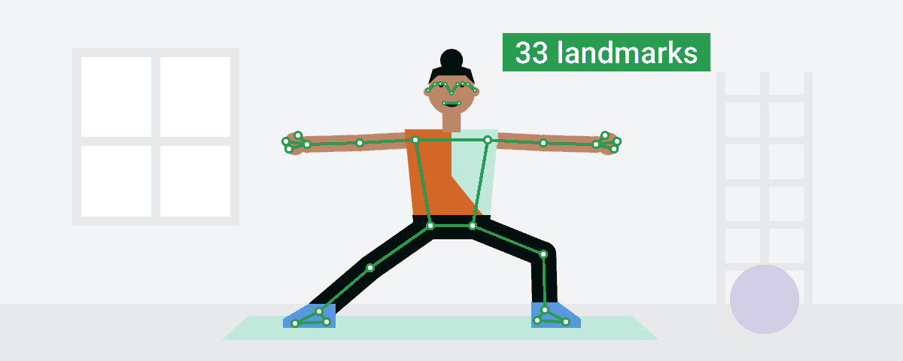

# BlazePose GHUM Heavy 3D

## Overview

BlazePose GHUM Heavy 3D is the largest MediaPipe pose landmark model. Your
application finds a person, crops a square region around them, and passes the
256×256 RGB crop to the model. The model returns 33 body landmarks in the crop
with visibility scores, the probability that the crop holds a person, and the
same landmarks in 3D, in metres around the hips. It runs as one component.

## Inputs and outputs

**Input.** `input_1` is one RGB crop: a square 1.25 times the longer side of
the person's box, edge pixels repeated beyond the image, resized bilinearly to
256×256 and scaled to 0–1, as a 1×256×256×3 (height, width, channel) float
tensor.

**Outputs.**

- `Identity` [1, 195]: 39 records of x, y, z, visibility logit, and presence logit, in crop pixels.
- `Identity_1` [1, 1]: the probability that the crop holds a person.
- `Identity_4` [1, 117]: 39 records of x, y, z in metres around the hip midpoint.

1. Keep the crop when `Identity_1` is at least 0.5; it needs no sigmoid.
2. Use the first 33 records of `Identity` and `Identity_4`; the rest only help place the next frame's crop.
3. Apply a sigmoid to the visibility and presence logits.
4. For a square crop of side s at (left, top), a landmark is at left + x × s / 256 and top + y × s / 256; if the application rotated the crop, undo it.
5. z is depth relative to the hip midpoint, on roughly the scale of x.
6. Rotate the world landmarks back by the same angle.

The landmarks, with the person's left side first in each pair, are: 0 nose;
1–3 left eye inner, center, outer; 4–6 right eye inner, center, outer; 7–8
ears; 9–10 mouth corners; 11–12 shoulders; 13–14 elbows; 15–16 wrists; 17–18
pinkies; 19–20 index fingers; 21–22 thumbs; 23–24 hips; 25–26 knees; 27–28
ankles; 29–30 heels; 31–32 foot tips.

No Neat decoder handles these outputs.

## Building applications

Run the package with the [Neat Model
API](https://developer.sima.ai/software/develop-apps/development-workflow/model).
For complete applications, start from the [Neat example
apps](https://developer.sima.ai/examples).
