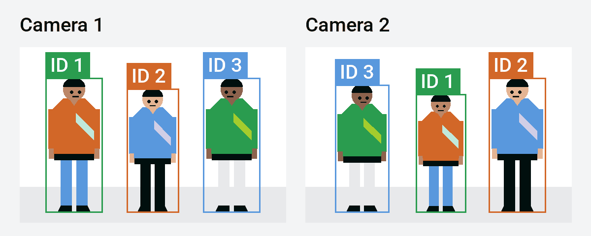

# BoT ReID R50

## Overview

BoT ReID R50 is fast-reid's bag-of-tricks person re-identification network: a
ResNet-50 with a batch-norm neck, trained on the Market-1501 pedestrian dataset.
It takes a cropped image of one person, 256 pixels high and 128 wide, and returns
a 2,048-value embedding. Crops of the same person from different cameras or
moments give embeddings that point the same way, so your application matches
people by comparing embeddings. The model runs as one component.

## Inputs

One input, `images`: a 256×128×3 (height, width, channel) RGB person crop with values from 0 to 255.

Preprocessing:

1. Crop one person from the frame, for example with a person detector.
2. Resize the crop to 128×256 (width × height) with bicubic resampling.
3. Keep the RGB values from 0 to 255, with no mean or standard deviation: the model subtracts the ImageNet mean and divides by the standard deviation itself.

## Outputs

One output, `embedding`, with 2,048 values for the person in the crop.

Postprocessing:

1. Divide `embedding` by its L2 norm.
2. Compare two people by the dot product of their normalized embeddings: values near 1 mean the same person.
3. To find a person in a gallery of earlier crops, rank the gallery by that similarity, highest first.

There are no classes: identities come from the gallery your application keeps.

## Building applications

Run the package with the [Neat Model
API](https://developer.sima.ai/software/develop-apps/development-workflow/model).
For complete applications, start from the [Neat example
apps](https://developer.sima.ai/examples).
