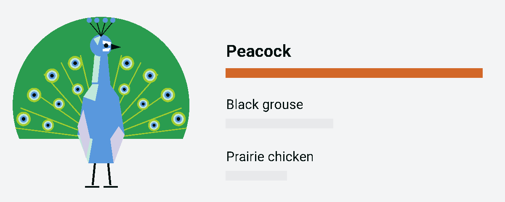

# DenseNet-161

## Overview

DenseNet-161 sorts an image into one of the 1,000 ImageNet classes, such as
animals, vehicles, and household objects. Use it to tag or sort photos, or to
check what a camera is looking at. It returns one score for each class, and your
application reports the most likely ones. It names the main subject of the image
and does not locate it. It is the 161-layer model of the DenseNet family. The
package uses torchvision's ImageNet weights (IMAGENET1K_V1).

## Inputs

One 224×224 RGB image, normalized with the ImageNet mean and standard deviation.

- With Neat: pass your frame as an image, with stretch resizing and the ImageNet normalization preset.
- Yourself: resize with bicubic resampling so the shorter side is 256, then crop the center 224×224. Scale to 0–1, subtract (0.485, 0.456, 0.406), divide by (0.229, 0.224, 0.225), and pass a 224×224×3 (height, width, channel) float tensor with Neat's resize, color conversion, and normalization off.

Neat's stretch fits the whole frame into the square and changes its proportions.
The center crop keeps the proportions and drops the edges. The original model
expects the resize and center crop, so prepare the image yourself for results
closest to it.

## Outputs

One score for each of the 1,000 classes, in `logits`. Neat has no decoder for this model, so your application ranks the scores.

1. Apply a softmax to `logits` to get class probabilities.
2. Take the highest probability as the class, or the five highest as the top-5 classes.

Class index i is the i-th ImageNet-1k WordNet ID in sorted order, which is the
standard ImageNet-1k class order.

## Building applications

Run the package with the [Neat Model
API](https://developer.sima.ai/software/develop-apps/development-workflow/model).
For complete applications, start from the [Neat example
apps](https://developer.sima.ai/examples).
