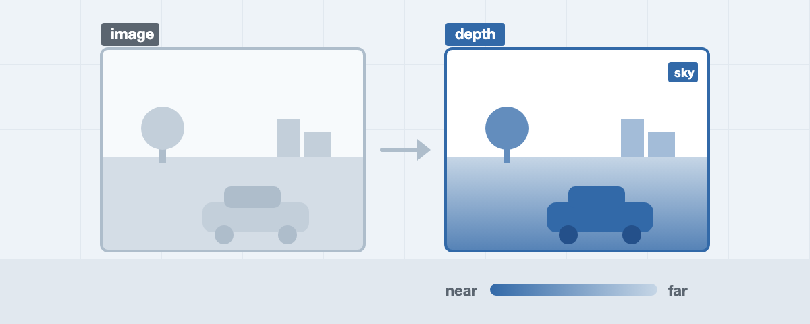

# Depth Anything 3 Metric Large 280x504



## Overview

Depth Anything 3 Metric Large is ByteDance Seed's monocular metric depth model.
This package runs it on one 280×504 RGB view and returns a canonical depth map
and a sky score map. Multiplying the depth by the camera's focal length in input
pixels and dividing by 300 gives meters. Depth accuracy is measured as AbsRel and
δ1 on a Modalix DevKit over the 654 NYU Depth V2 Eigen test frames. The 280×504
center crop drops the top and bottom of a 4:3 frame, so the model sees less of the
scene than upstream's default inference. The model is distributed under Apache-2.0.

## Usage

Download a published build from the `develop` catalog:

```bash
sima-cli models download \
  --id depth_anything_3_metric_large_280x504 \
  --variant modalix_bf16 \
  --branch develop
```

The MPK returns raw network outputs. Convert the depth to meters and apply the
sky mask in the application as described below; `scripts/accuracy.py` contains a
reference conversion.

## Model interface

Each image is resized as in upstream inference so that it covers 280×504, with
bicubic sampling when it is enlarged and area sampling when it is shrunk, and the
center 280×504 is cropped. A 640×480 NYU frame, for example, becomes 504×378 and
loses 49 rows at the top and bottom. The RGB pixels are scaled to `[0, 1]` and
normalized with the ImageNet mean `(0.485, 0.456, 0.406)` and standard deviation
`(0.229, 0.224, 0.225)`. The ONNX input `image` is that image as an NCHW FP32
tensor with shape `1×3×280×504`. With Neat, pass the same image as an HWC FP32
tensor with shape `280×504×3`, give its layout explicitly, and turn off Neat's
resize, color conversion, and normalization.

The model emits two FP32 maps at input resolution. The MPK returns them in this
order, laid out as NHWC:

| Output | ONNX shape | MPK shape | Contents |
| --- | --- | --- | --- |
| `depth` | `1×1×280×504` | `1×280×504×1` | canonical depth, positive |
| `sky` | `1×1×280×504` | `1×280×504×1` | sky score; pixels at or above 0.3 are sky |

Metric depth in meters is `focal × depth / 300`, where `focal` is the mean of the
camera's horizontal and vertical focal lengths in pixels of the 280×504 input.
Resizing scales the original focal length by the resize factor; cropping leaves it
unchanged. Upstream replaces the depth of sky pixels after the network; this
package returns the network's depth for every pixel and leaves that step to the
application.

## Available builds

The registry declares one build profile, `modalix_bf16`, with one `model`
component. It compiles the whole network into one MLA segment; the compile recipe
rejects a build that places any layer on the A65 or APU. Weights and activations
run in BF16, LayerNorm keeps float32 intermediates, and the compiler calibrates
with histogram MSE over 2,048 bins on 46 NYU Depth V2 training frames.

## Quality and performance

On a Modalix DevKit, `scripts/accuracy.py` measures AbsRel and δ1 on the 654-frame
NYU Depth V2 Eigen test set. It converts the output to meters with the NYU color
camera's focal length and compares each valid ground-truth pixel inside the Eigen
crop with the network pixel that covers it. Ground-truth depths outside 0.001 to
10 meters and pixels that the center crop removes are not scored. Each metric is
the mean of the per-frame values. The `nyu_depth_accuracy` result is published as
an accuracy run, and the model browser shows it beside the
[published score](https://arxiv.org/abs/2511.10647) for DA3METRIC-LARGE on NYU
Depth V2 (Table 11): AbsRel 0.070 and δ1 0.963.

The paper does not state its evaluation resolution; upstream's default inference
resizes a 640×480 frame to 378×504 and keeps the whole frame. This package sees a
280×504 center crop, so it predicts from less context and is scored on fewer
pixels.

The benchmark script runs Neat Core's default synthetic benchmark on the MPK, and
CI publishes one result for the build.

## Source and license

The source is the `model.safetensors` checkpoint and `config.json` from the
DA3METRIC-LARGE repository on Hugging Face. The network code comes from the
`depth-anything-3` 0.1.1 wheel on PyPI, which builds the network that
`config.json` names.

- [DA3METRIC-LARGE model card](https://huggingface.co/depth-anything/DA3METRIC-LARGE)
- [Pinned checkpoint revision](https://huggingface.co/depth-anything/DA3METRIC-LARGE/tree/4010e39f3634a45bc60553321fb49fb760bd594e)
- [Depth Anything 3 source](https://github.com/ByteDance-Seed/Depth-Anything-3/tree/41736238f5bced4debf3f2a12375d2466874866d)
- [Depth Anything 3 paper](https://arxiv.org/abs/2511.10647)

DA3METRIC-LARGE is distributed under Apache-2.0.

## Reproducing the artifact

### Conversion

The `conversion.default` entry in `model.yaml` pins the checkpoint, its
`config.json`, and the `depth-anything-3` wheel. `scripts/requirements-convert.txt`
pins only the packages the export imports. `convert.py` unpacks the wheel's
`depth_anything_3` package into a temporary directory instead of installing it,
so none of the wheel's other declared dependencies, such as Open3D, MoviePy,
pycolmap, and xformers, are needed. It checks that `config.json` matches the
wheel's preset, loads the checkpoint strictly, and exports the network through
its depth head at opset 17 with a fixed position table and explicit attention. It
then folds constants with onnxsim, so surgery starts from a static graph. On Linux
ARM64, the shared runner script converts in a fresh Python 3.12 environment built
from those requirements:

```bash
scripts/run_model_conversion.sh models/depth_anything_3_metric_large_280x504 default \
  /tmp/depth-anything-3-export
```

Before exporting, `convert.py` checks that the full upstream forward differs from
the exported head only in the depth of sky pixels. It then compares the ONNX
outputs with PyTorch on four synthetic inputs. To publish a conversion, manually
run **Vulcan Model Convert** with model `depth_anything_3_metric_large_280x504`
and copy the printed source pin into `model.yaml` only after surgery and compiler
validation. The smoke comparison does not measure model accuracy.

### Calibration and compilation

`surgery.py` rewrites how values move without changing them. Each attention block
selects Q, K, and V with a channel split instead of a 5-D transpose and gather.
Each of the four depth-head taps drops the class token before its LayerNorm, so
every LayerNorm normalizes a 3-D token tensor. Identity reshapes and casts are
removed and chains of reshapes and transposes are collapsed, so every tensor has at
most four dimensions.

Calibration uses 46 frames drawn with a fixed seed from the `train` split of the
NYU Depth V2 dataset, so no scored Eigen test frame calibrates the model. In the
pinned Model Compiler environment, compile the build with the shared runner
script. It resolves the source and the calibration archive, runs
`scripts/compile.py`, and validates the MPK:

```bash
scripts/run_model_compilation.sh models/depth_anything_3_metric_large_280x504 \
  modalix_bf16 model /tmp/depth-anything-3
```

The MPK lands in
`/tmp/depth-anything-3/depth_anything_3_metric_large_280x504/modalix_bf16/model/`.
Rewritten graphs and generated models stay in a temporary directory outside Git.

### DevKit accuracy

The `nyu_depth_accuracy` entry declares the NYU Depth V2 dataset archive, the
published metrics, and the paper's reference score. On a Modalix DevKit, run the
accuracy stage on the output of `scripts/run_model_compilation.sh`, setting
`REGISTRY_PYTHON` to a Python that has the full Model Registry tooling and Dataset
Registry:

```bash
scripts/run_model_accuracy.sh models/depth_anything_3_metric_large_280x504 \
  modalix_bf16 /tmp/depth-anything-3 /media/nvme/neat-tests/depth-anything-3-accuracy
```

The accuracy script needs only NumPy and OpenCV from PyNeat's environment. The
runner extracts the archive under `/media/nvme/neat-tests/` and removes it when
it exits. See
[Accuracy on the DevKit](../../docs/local-accuracy-development.md#accuracy-on-the-devkit)
for the result format and publication.
