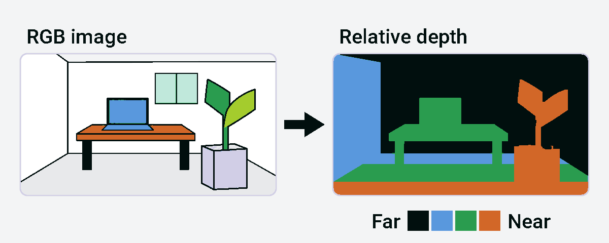

# Depth Anything 3 Small 504×280

## Overview

Depth Anything 3 Small estimates how far away every pixel of an image is, from
a single camera view. Use it for obstacle avoidance, scene understanding, or
separating near surfaces from far ones. It returns a depth map and a matching
confidence map that marks uncertain regions. The depth is relative: the values
are not meters. This package takes one 280×504 image at a time, which suits a
16:9 camera, and needs no camera pose, focal length, or second view. It does
not return the camera pose or the rays of the original model.

## Inputs

One 280×504 (height × width) RGB image, normalized with the ImageNet mean and standard deviation.

- With Neat: pass your frame as an image, with letterbox resizing and the ImageNet normalization preset.
- Yourself: resize, keeping the aspect ratio, until the image covers 280×504, with area interpolation when shrinking and bicubic when enlarging. Center-crop to 280×504, divide by 255, subtract (0.485, 0.456, 0.406), divide by (0.229, 0.224, 0.225), and pass a 280×504×3 (height, width, channel) float32 tensor with Neat's preprocessing off.

Neat's letterbox pads the frame, where the manual path crops it. With Neat, the
two maps therefore also cover the padded border.

## Outputs

A depth map and a confidence map, one value per input pixel. Neat has no decoder for them.

| Tensor | Size | Holds |
|---|---|---|
| `depth` | 280×504 values | relative depth: larger is farther, with an unknown scale and shift in inverse depth |
| `depth_conf` | 280×504 values | confidence: larger is more certain |

1. Read the two outputs in this order and reshape each to 280×504.

## Building applications

Run the package with the [Neat Model API](https://developer.sima.ai/software/develop-apps/development-workflow/model). For complete applications, start from the [Neat example apps](https://developer.sima.ai/examples).
