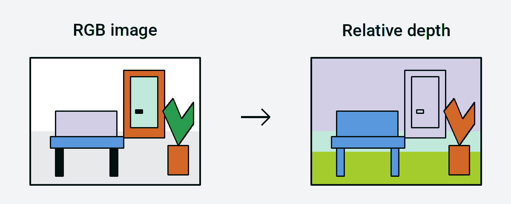

# Depth Anything 3 Small 504×378

## Overview

Depth Anything 3 Small estimates how far away every pixel of an image is, from
a single camera view. Use it for obstacle avoidance, scene understanding, or
separating near surfaces from far ones. It returns a depth map and a matching
confidence map that marks uncertain regions. The depth is relative: the values
are not meters. This package takes one 378×504 image at a time, which suits a
4:3 camera, and needs no camera pose, focal length, or second view. It does
not return the camera pose or the rays of the original model.

## Inputs

One 378×504×3 (height, width, channel) RGB image, normalized with the ImageNet mean and standard deviation.

Preprocessing:

1. Resize, keeping the aspect ratio, until the image covers 378×504. Use area interpolation when shrinking and bicubic when enlarging.
2. Crop the center 378×504.
3. Divide by 255.
4. Subtract (0.485, 0.456, 0.406) and divide by (0.229, 0.224, 0.225).

## Outputs

| Output | Size | Holds |
|---|---|---|
| `depth` | 378×504 values | relative depth: larger is farther, with an unknown scale and shift in inverse depth |
| `depth_conf` | 378×504 values | confidence: larger is more certain |

Postprocessing:

1. Read the two outputs in this order and reshape each to 378×504.

## Building applications

Run the package with the [Neat Model API](https://developer.sima.ai/software/develop-apps/development-workflow/model). For complete applications, start from the [Neat example apps](https://developer.sima.ai/examples).
