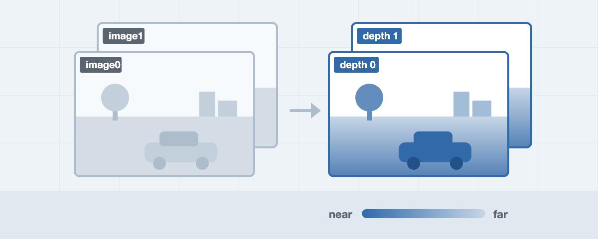

# Depth Anything 3 Small 280x504



## Overview

Depth Anything 3 Small is ByteDance Seed's smallest any-view depth model. This
package runs it on two 280×504 RGB views of one scene and returns, for each view,
a depth map, a confidence map, and a camera pose encoding. The depth
has no metric scale. Depth accuracy is measured as AbsRel and δ1 after a per-frame
scale-and-shift alignment, on a Modalix DevKit over 506 KITTI frames, each paired
with the nearest frame of its drive. The model is distributed under Apache-2.0.

## Usage

Download a published build from the `develop` catalog:

```bash
sima-cli models download \
  --id depth_anything_3_small_280x504 \
  --variant modalix_bf16 \
  --branch develop
```

The MPK returns raw network outputs. Align or scale the depth and decode the
camera poses in the application as described below; `scripts/accuracy.py`
contains a reference depth alignment.

## Model interface

Each view is resized as in upstream inference so that it covers 280×504, with
bicubic sampling when it is enlarged and area sampling when it is shrunk, and the
center 280×504 is cropped. A 1242×375 KITTI frame, for example, becomes 927×280
and loses 211 columns on the left and 212 on the right. The RGB pixels are scaled
to `[0, 1]` and normalized with the ImageNet mean `(0.485, 0.456, 0.406)` and
standard deviation `(0.229, 0.224, 0.225)`. The ONNX inputs `image0` and `image1`
are the two views as NCHW FP32 tensors with shape `1×3×280×504`. `image0` is the
reference view, and the predicted camera poses are relative to it. With Neat,
pass each view as an HWC FP32 tensor with shape `280×504×3`, give its layout
explicitly, and turn off Neat's resize, color conversion, and normalization.

The model emits three FP32 outputs. The MPK returns them in this order, with the
depth and confidence maps laid out as NHWC:

| Output | ONNX shape | MPK shape | Contents |
| --- | --- | --- | --- |
| `depth` | `1×2×280×504` | `1×280×504×2` | depth of each view, positive, one scale for both views |
| `depth_conf` | `1×2×280×504` | `1×280×504×2` | depth confidence of each view, higher is more confident |
| `pose_enc` | `1×2×9` | `1×2×9` | camera of each view |

Channel 0 of `depth` and `depth_conf` belongs to `image0`. Each view's `pose_enc`
holds the camera-to-world translation (3 values), the rotation as an xyzw
quaternion (4 values), and the vertical and horizontal fields of view in radians.
The focal lengths in input pixels are `140 / tan(fov_v / 2)` and
`252 / tan(fov_h / 2)`, with the principal point at the image center. Upstream
reports the world-to-camera extrinsics, which invert the camera-to-world pose.

## Available builds

The registry declares one build profile, `modalix_bf16`, with one `model`
component. It compiles the whole network into one MLA segment; the compile recipe
rejects a build that places any layer on the A65 or APU. Weights and activations
run in BF16, LayerNorm keeps float32 intermediates, and the compiler calibrates
with histogram MSE over 2,048 bins on 50 KITTI view pairs.

## Quality and performance

On a Modalix DevKit, `scripts/accuracy.py` measures AbsRel and δ1 on the KITTI
test frames of the 21 drives that calibration does not use, 506 frames in all.
Each frame is `image0`, and the nearest other frame of its drive is `image1`; of
two equally near frames, the later one is used. Each valid ground-truth pixel is
compared with the `image0` depth pixel that covers it. Ground-truth depths outside
0.001 to 80 meters and pixels that the center crop removes are not scored.
Because the depth has no metric scale, a least-squares scale and shift maps the
predicted inverse depth onto the inverse ground truth of each frame, as in the
Depth Anything V1 and V2 evaluations, before the frame is scored in depth. Each
metric is the mean of the per-frame values. The `kitti_depth_accuracy` result is
published as an accuracy run. The paper reports no score for DA3-SMALL under this
protocol, so the registry declares no reference.

The benchmark script runs Neat Core's default synthetic benchmark on the MPK, and
CI publishes one result for the build.

## Source and license

The source is the `model.safetensors` checkpoint and `config.json` from the
DA3-SMALL repository on Hugging Face. The network code comes from the
`depth-anything-3` 0.1.1 wheel on PyPI, which builds the network that
`config.json` names.

- [DA3-SMALL model card](https://huggingface.co/depth-anything/DA3-SMALL)
- [Pinned checkpoint revision](https://huggingface.co/depth-anything/DA3-SMALL/tree/e08cab65ca0ec38e7826075418411ab90cab4da3)
- [Depth Anything 3 source](https://github.com/ByteDance-Seed/Depth-Anything-3/tree/41736238f5bced4debf3f2a12375d2466874866d)
- [Depth Anything 3 paper](https://arxiv.org/abs/2511.10647)

DA3-SMALL is distributed under Apache-2.0.

## Reproducing the artifact

### Conversion

The `conversion.default` entry in `model.yaml` pins the checkpoint, its
`config.json`, and the `depth-anything-3` wheel. `scripts/requirements-convert.txt`
pins only the packages the export imports. `convert.py` unpacks the wheel's
`depth_anything_3` package into a temporary directory instead of installing it,
so none of the wheel's other declared dependencies, such as Open3D, MoviePy,
pycolmap, and xformers, are needed. It checks that `config.json` matches the
wheel's preset and loads the checkpoint. The checkpoint omits six LayerNorm
parameters of an auxiliary head that the export does not use; the script requires
exactly those to be missing, as upstream's own non-strict load leaves them. It
exports the two-view network through its depth head and camera decoder at opset
17, with fixed positional tables, explicit attention, and the camera token written
by concatenation. It then folds constants with onnxsim, so surgery starts from a
static graph. On Linux ARM64, the shared runner script converts in a fresh Python
3.12 environment built from those requirements:

```bash
scripts/run_model_conversion.sh models/depth_anything_3_small_280x504 default \
  /tmp/depth-anything-3-export
```

Before exporting, `convert.py` checks that the full upstream forward returns the
same depth and confidence as the exported head and decodes `pose_enc` into the
cameras it reports. It then compares the ONNX outputs with PyTorch on four
synthetic view pairs. To publish a conversion, manually run **Vulcan Model
Convert** with model `depth_anything_3_small_280x504` and copy the printed source
pin into `model.yaml` only after surgery and compiler validation. The smoke
comparison does not measure model accuracy.

### Calibration and compilation

`surgery.py` rewrites how values move without changing them. The export computes
both views as a batch of two except in the global attention blocks, and the MLA
expects batch one, so every operation on that batch is cloned once per view; the
clones share weights, and the per-view results are concatenated wherever the
export stacked the views. Each attention block selects Q, K, and V with a channel
split instead of a 5-D transpose and gather. The head reads the depth and
confidence channels from its NCHW output instead of through an NHWC transpose.
Identity reshapes and casts are removed and chains of reshapes and transposes are
collapsed, so every tensor has batch one and at most four dimensions.

Calibration uses KITTI test frames from the seven drives that have frames at most
five indices apart. Each such pair of consecutive frames is a short-baseline view
pair, with the earlier frame as `image0`; 50 of the 126 pairs are drawn with a
fixed seed. Accuracy scores only the other 21 drives. In the pinned Model Compiler
environment, compile the build with the shared runner script. It resolves the
source and the calibration archive, runs `scripts/compile.py`, and validates the
MPK:

```bash
scripts/run_model_compilation.sh models/depth_anything_3_small_280x504 \
  modalix_bf16 model /tmp/depth-anything-3
```

The MPK lands in
`/tmp/depth-anything-3/depth_anything_3_small_280x504/modalix_bf16/model/`.
Rewritten graphs and generated models stay in a temporary directory outside Git.

### DevKit accuracy

The `kitti_depth_accuracy` entry declares the KITTI dataset archive and the
published metrics. On a Modalix DevKit, run the accuracy stage on the output of
`scripts/run_model_compilation.sh`, setting `REGISTRY_PYTHON` to a Python that has
the full Model Registry tooling and Dataset Registry:

```bash
scripts/run_model_accuracy.sh models/depth_anything_3_small_280x504 \
  modalix_bf16 /tmp/depth-anything-3 /media/nvme/neat-tests/depth-anything-3-accuracy
```

The accuracy script needs only NumPy and OpenCV from PyNeat's environment. The
runner extracts the archive under `/media/nvme/neat-tests/` and removes it when
it exits. See
[Accuracy on the DevKit](../../docs/local-accuracy-development.md#accuracy-on-the-devkit)
for the result format and publication.
