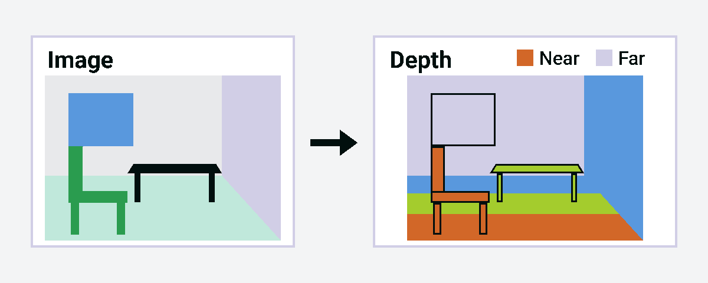

# Depth Anything V2 Small

## Overview

Depth Anything V2 Small estimates how far away every pixel of an image is. It
pairs a small vision transformer encoder (ViT-S, 14×14 patches) with a DPT
decoder that fuses four encoder layers into one dense map. It takes a 518×686
RGB image and returns a 518×686 map of relative inverse depth, where larger
values are closer. The values have an unknown scale and offset, so your
application aligns them to real distances when it needs them. The model runs
as one component.

## Inputs and outputs

**Input.** Scale the RGB values to 0–1, then resize the image to 518×686
(height × width) with bicubic resampling. That size approximates a 640×480
frame's aspect ratio while keeping both dimensions divisible by 14.
Subtract the ImageNet mean (0.485, 0.456, 0.406) and divide by the standard
deviation (0.229, 0.224, 0.225). The reference scripts pass this image as a
518×686×3 (height, width, channel) float tensor, with Neat's resize, color
conversion, and normalization turned off.

**Outputs.** `predicted_depth` holds 518×686 values of relative inverse depth.

1. Resize `predicted_depth` to your image's resolution with bilinear interpolation, keeping the corner pixels aligned.
2. For a relative depth view, use the values directly: larger is closer.
3. For metric depth, fit a scale s and an offset t so that s × value + t matches 1 / distance at points of known distance, such as from a depth sensor.
4. Take each pixel's distance as 1 / (s × value + t), capped at the farthest distance your scene can contain.

## Building applications

Run the package with the [Neat Model API](https://developer.sima.ai/software/develop-apps/development-workflow/model). For complete applications, start from the [Neat example apps](https://developer.sima.ai/examples).
