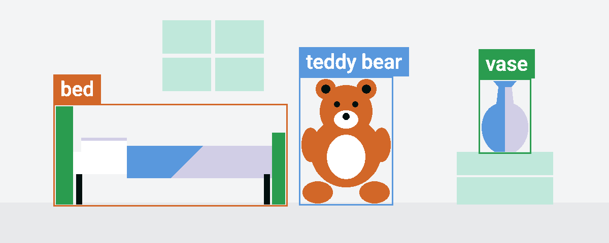

# DETR ResNet-101

## Overview

DETR ResNet-101 finds everyday objects in an image and returns a box, a class,
and a score for each. Use it to count, track, or monitor objects in camera
streams. It knows the COCO classes and returns at most 100 detections per image.
It is the larger of the two original DETR detectors from Facebook AI Research,
with a ResNet-101 backbone. The ResNet-101 one is more accurate and slower. Each
object is predicted once, so there are no overlapping boxes to remove.

## Inputs and outputs

**Input.** One 640×640 RGB image, normalized with the ImageNet mean and standard deviation.

- With Neat: pass your frame as an image, with stretch resizing and the ImageNet normalization preset.
- Yourself: stretch to exactly 640×640 with bilinear resampling. Scale to 0–1, subtract (0.485, 0.456, 0.406), divide by (0.229, 0.224, 0.225), and pass a 640×640×3 (height, width, channel) float tensor.

Do not pad the image. The model reads padding as part of the scene, which
lowers accuracy.

**Outputs.** Up to 100 detections, each a box, a class index, and a score.

- With Neat: the DETR box decoder (`BoxDecodeType.Detr`) returns the detections, with boxes in the original frame. Set `top_k` and `score_threshold`.
- Yourself: decode these tensors.

| Tensor | Size | Holds |
|---|---|---|
| `logits` | 100 rows of 92 values | class logits per query |
| `box_logits` | 100 rows of 4 values | box logits per query |

1. Apply a softmax to each query's 92 logits.
2. Drop the last class, which means no object. The best remaining class and its probability are the class and the score.
3. Keep the queries whose score passes your threshold.
4. Apply a sigmoid to the 4 box logits to get the box as (cx, cy, w, h), fractions of the image.
5. The corners are (cx - w/2, cy - h/2) and (cx + w/2, cy + h/2). Multiply x by the image width and y by the image height.

Class index i is COCO category ID i. Eleven of the first 91 indexes are unused.

## Building applications

Run the package with the [Neat Model
API](https://developer.sima.ai/software/develop-apps/development-workflow/model).
For complete applications, start from the [Neat example
apps](https://developer.sima.ai/examples).
