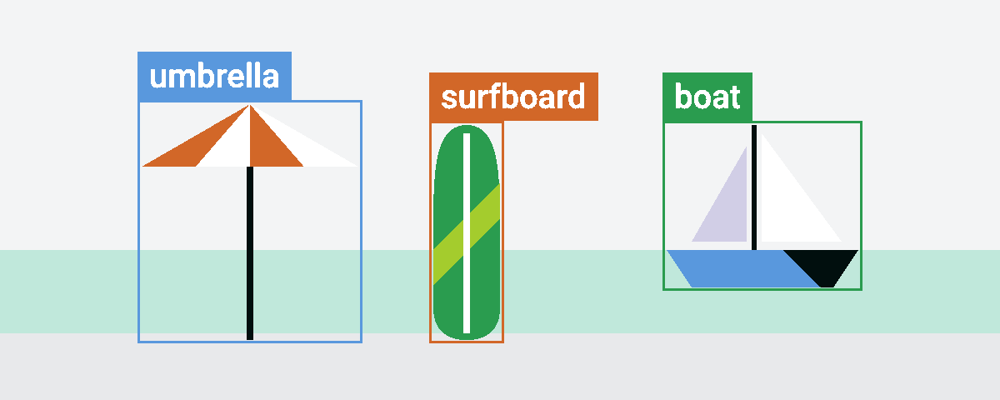

# DETR ResNet-50

## Overview

DETR ResNet-50 is Facebook AI Research's original DETR transformer object detector
with a ResNet-50 backbone, trained on COCO. It takes one RGB image and returns 100
detections, each a box with scores for 91 COCO category slots and a "no
object" class. It runs as one component that holds the backbone, the
transformer encoder and decoder, and both prediction heads. DETR predicts each
object once, so the application does not need to remove overlapping boxes.

## Inputs and outputs

**Input.** Scale the image with bilinear resampling to fit 1280×720 (width ×
height), keeping the aspect ratio, and center it on a 1280×720 canvas filled
with the pixel value 114. Scale the RGB values to 0–1, subtract the ImageNet
mean (0.485, 0.456, 0.406), and divide by the standard deviation (0.229, 0.224,
0.225). Pass this image as a 720×1280×3 (height, width, channel) float tensor,
or let Neat letterbox and normalize the frame with its ImageNet preset.

**Outputs.** The package returns `logits`, 92 class logits for each of 100
queries, and `pred_boxes`, 100 boxes as normalized (cx, cy, w, h).

1. Apply a softmax over the 92 logits of each query.
2. Drop the last class, which means no object, and take the best remaining class and its probability as the score.
3. Keep the queries whose score passes your threshold.
4. Convert each box to corners: (cx - w/2, cy - h/2) and (cx + w/2, cy + h/2).
5. Multiply x by 1280 and y by 720, subtract the left and top padding, and divide by the resize scale to reach image pixels.

Class index i is COCO category ID i. Eleven of the first 91 indexes are unused.
No Neat box decoder reads these outputs, so decode them on the CPU.

## Building applications

Run the package with the [Neat Model
API](https://developer.sima.ai/software/develop-apps/development-workflow/model).
For complete applications, start from the [Neat example
apps](https://developer.sima.ai/examples).
