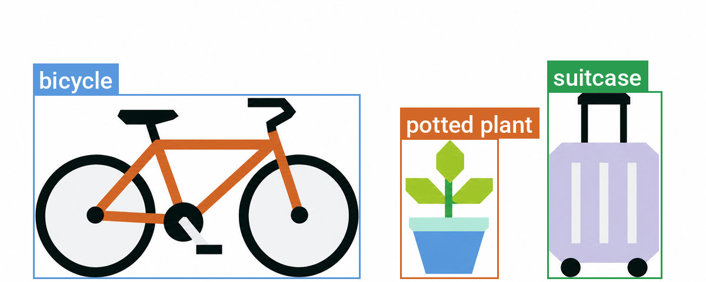

# D-FINE Nano

## Overview

D-FINE Nano finds everyday objects in an image, such as people, vehicles, and
animals, and returns a box, a class, and a score for each one. Use it to count,
track, or monitor objects in camera streams. It knows the 80 COCO classes. It is
the Nano size of the D-FINE detector. The model runs in two parts, and your
application picks the 300 best candidates on the CPU between them. Each object
is predicted once, so there are no overlapping boxes to remove.

## Inputs and outputs

### Inputs

One 640×640 RGB image with values from 0 to 1.

- With Neat: pass your frame as an image, with stretch resizing and normalization with mean 0 and standard deviation 1, which only scales the values to 0–1.
- Yourself: stretch to 640×640 with bilinear resampling and divide by 255. Do not apply the ImageNet mean and standard deviation. Pass a 640×640×3 (height, width, channel) float tensor with Neat's preprocessing off.

### Between the components

The backbone returns `attention_memory` and `query_content`, 2,000 rows of 128 values each, `proposal_scores`, 2,000 values, and `reference_logits`, 2,000 rows of 4 values.

1. Take the 300 highest `proposal_scores`, breaking ties by the lower index.
2. Gather those rows of `query_content` and `reference_logits` in that order, without changing their values.
3. Pass both, with the whole `attention_memory`, to the decoder.

### Outputs

Up to 300 detections, each a box, a class index, and a score. Neat has no decoder for this model, so decode these tensors.

| Tensor | Size | Holds |
|---|---|---|
| `pred_boxes` | 300 rows of 4 values | boxes as (cx, cy, width, height), fractions of the image |
| `pred_logits` | 300 rows of 80 values | class logits per box |

1. Apply a sigmoid to `pred_logits` and rank all 300×80 box-class pairs by score.
2. Keep the 300 best pairs. One box can appear with several classes.
3. The corners are (cx - width/2, cy - height/2) and (cx + width/2, cy + height/2). Multiply x by the image width and y by the image height, clip to the image, and drop boxes left empty.

Class index i is the i-th COCO category ID in ascending order.

## Building applications

Run the package with the [Neat Model
API](https://developer.sima.ai/software/develop-apps/development-workflow/model).
For complete applications, start from the [Neat example
apps](https://developer.sima.ai/examples).
