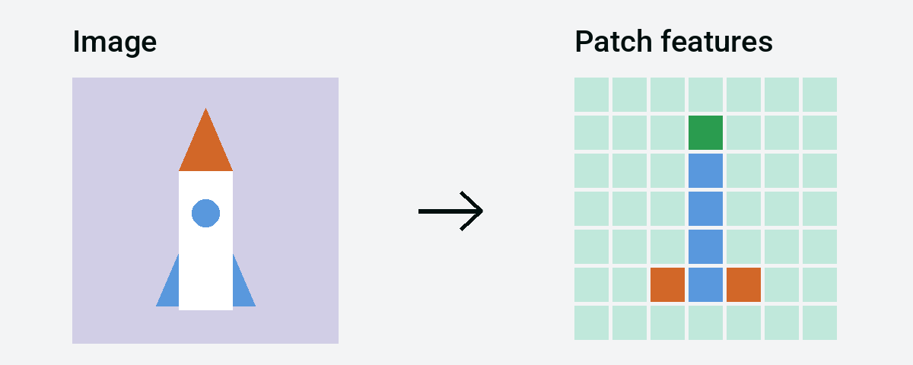

# DINOv3 ConvNeXt Large

## Overview

DINOv3 ConvNeXt Large turns an image into embeddings: lists of numbers that
describe what the image shows, without a fixed set of classes. Use it to find
similar images, to group or deduplicate them, or as the frozen base under a
small classification or segmentation head that you train yourself. It returns
one embedding for the whole image and one for each cell of a 7×7 grid. It names
no objects on its own; your application compares the embeddings. It comes from
Meta.

## Inputs

One 224×224×3 (height, width, channel) RGB image, normalized with the ImageNet mean and standard deviation.

Preprocessing:

1. Resize straight to 224×224 with an antialiased bilinear filter, without cropping or keeping the aspect ratio.
2. Divide by 255.
3. Subtract the mean (0.485, 0.456, 0.406).
4. Divide by the standard deviation (0.229, 0.224, 0.225).

## Outputs

| Output | Size | Holds |
|---|---|---|
| `class_embedding` | 1,536 values | the whole image |
| `patch_embeddings` | 49 rows of 1,536 values | one 32×32-pixel patch per row |

Postprocessing:

1. To compare two images, divide each `class_embedding` by its length and take their dot product, the cosine similarity. A higher value means more similar images.
2. Row i of `patch_embeddings` is the patch in grid row i ÷ 7, rounded down, and grid column i mod 7, counting from the top left.

## Building applications

Run the package with the [Neat Model
API](https://developer.sima.ai/software/develop-apps/development-workflow/model).
For complete applications, start from the [Neat example
apps](https://developer.sima.ai/examples).
