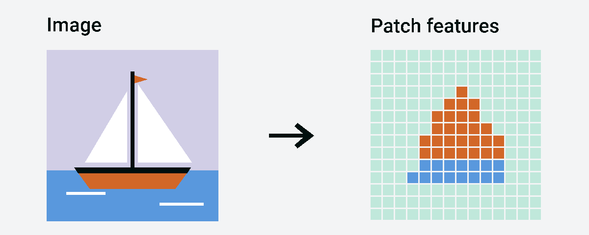

# DINOv3 ViT-B/16

## Overview

DINOv3 ViT-B/16 is Meta's self-supervised vision transformer. Meta trained it
without labels on 1.7 billion images, so its features describe what an image
shows without being tied to a fixed set of classes. It takes a 224×224 RGB
image and returns a 768-value embedding for the whole image and one for each of
its 196 patches of 16×16 pixels. Compare image embeddings to search or group
images, or train a small head on them; use the patch embeddings for dense tasks
such as segmentation or depth. The model runs as one component.

## Inputs and outputs

**Input.** Resize the image straight to 224×224 with an antialiased bilinear
filter, without keeping its aspect ratio or cropping. Scale the RGB values to 0–1,
subtract the mean (0.485, 0.456, 0.406) and divide by the standard deviation
(0.229, 0.224, 0.225). Neat's image preprocessing applies the same mean and
standard deviation when it stretches the frame to the model input with its
ImageNet preset. The device's own resize is bilinear without antialiasing, so
when it shrinks a large frame the embeddings can differ noticeably from the
reference, which matters for search and grouping. For embeddings closest to the
reference, downscale the image on the CPU with an antialiased filter to 224×224
and pass that image.

**Outputs.** `class_embedding` holds 768 values that describe the whole image.
`patch_embeddings` holds 196 rows of 768 values, one row per patch.

1. Row i of `patch_embeddings` describes the patch in row i ÷ 14 and column i mod 14 of the 14×14 grid, counting from the top left and rounding the division down.
2. To compare two images, divide each `class_embedding` by its length and take their dot product, the cosine similarity. A higher value means more similar images.

## Building applications

Run the package with the [Neat Model API](https://developer.sima.ai/software/develop-apps/development-workflow/model). For complete applications, start from the [Neat example apps](https://developer.sima.ai/examples).
