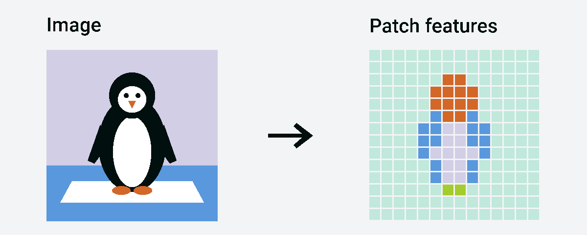

# DINOv3 ViT-S/16

## Overview

DINOv3 ViT-S/16 turns an image into embeddings: lists of numbers that describe
what the image shows, without a fixed set of classes. Use it to find similar
images, to group or deduplicate them, or as the frozen base under a small
classification, segmentation, or depth head that you train yourself. It returns
one embedding for the whole image and one for each cell of a 14×14 grid. It
names no objects on its own; your application compares the embeddings. It is the
Small size of Meta's DINOv3 ViT family.

## Inputs and outputs

### Inputs

One 224×224 RGB image, normalized with the ImageNet mean and standard deviation.

- With Neat: pass your frame as an image, with stretch resizing and the ImageNet normalization preset.
- Yourself: resize straight to 224×224 with an antialiased bilinear filter, without cropping or keeping the aspect ratio. Scale to 0–1, subtract (0.485, 0.456, 0.406), divide by (0.229, 0.224, 0.225), and pass a 224×224×3 (height, width, channel) float tensor.

Neat's resize does not antialias, so shrinking a large frame changes the
embeddings noticeably. For search and grouping, downscale the frame to 224×224
on the CPU with an antialiased filter and pass that image.

### Outputs

Two embedding tensors. Neat has no decoder for them; your application uses them directly.

| Tensor | Size | Describes |
|---|---|---|
| `class_embedding` | 384 values | the whole image |
| `patch_embeddings` | 196 rows of 384 values | one 16×16-pixel patch per row |

1. To compare two images, divide each `class_embedding` by its length and take their dot product, the cosine similarity. A higher value means more similar images.
2. Row i of `patch_embeddings` is the patch in row i ÷ 14, rounded down, and column i mod 14 of the grid, counting from the top left.

## Building applications

Run the package with the [Neat Model
API](https://developer.sima.ai/software/develop-apps/development-workflow/model).
For complete applications, start from the [Neat example
apps](https://developer.sima.ai/examples).
