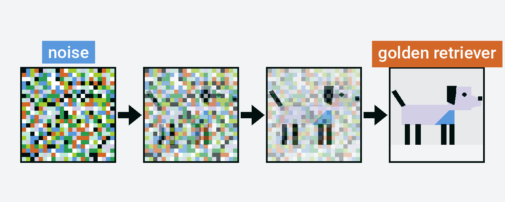

# DiT-XL/2 256

## Overview

DiT-XL/2 256 generates a 256 x 256 image of one of the 1000 ImageNet classes.
It starts from random noise and removes a little of it per step: four
transformer components, run in turn, predict the noise in a 4 x 32 x 32 latent
for the requested class and for no class, and your application combines the
two and steps the latent. After the last step, the VAE decoder component turns
the latent into the image.

## Inputs

Each of `transformer_0` to `transformer_3` takes these inputs, named with its own prefix, such as `transformer_2_class_one_hot`:

| Input | Size | Holds |
|---|---|---|
| `timestep_features` | [1, 256, 1, 1] | for i < 128, cos(t · 10000^(−i/127)) at i and sin of the same at 128 + i |
| `class_one_hot` | [1, 1001, 1, 1] | 1 at the class, or at the null class 1000 |
| `transformer_0_latent` | [1, 4, 32, 32] | the current latent, `transformer_0` only |
| `previous_hidden` | [1, 1152, 16, 16] | the previous part's `hidden`, parts 1-3 only |

Preprocessing:

1. Draw a [1, 4, 32, 32] latent from a standard normal distribution.
2. Choose the DDIM timesteps, for example 50 evenly spaced from 999 to 0, and a guidance scale, such as 4.

## Between the components

For each timestep t:

1. Run `transformer_0` to `transformer_3` twice, once with the class and once with the null class 1000, passing each part's `hidden` to the next part as `previous_hidden`.
2. From each pass, take channels 0-3 of `transformer_3_prediction` [1, 8, 32, 32].
3. Compute noise = null + scale · (class − null).
4. Take the DDIM step from t to the next timestep with that noise.

After the last step, pass the final latent unchanged to `vae_decoder_latent` [1, 4, 32, 32]; the component divides by 0.18215.

## Outputs

One output, `vae_decoder_image` [1, 3, 256, 256]: the generated RGB image, with values from −1 to 1.

Postprocessing:

1. Compute (x + 1) · 127.5.
2. Clip to 0 to 255 and convert to 8-bit pixels.

The class index is the ImageNet-1k class, from 0 to 999.

## Building applications

Run the package with the [Neat Model API](https://developer.sima.ai/software/develop-apps/development-workflow/model). For complete applications, start from the [Neat example apps](https://developer.sima.ai/examples).
