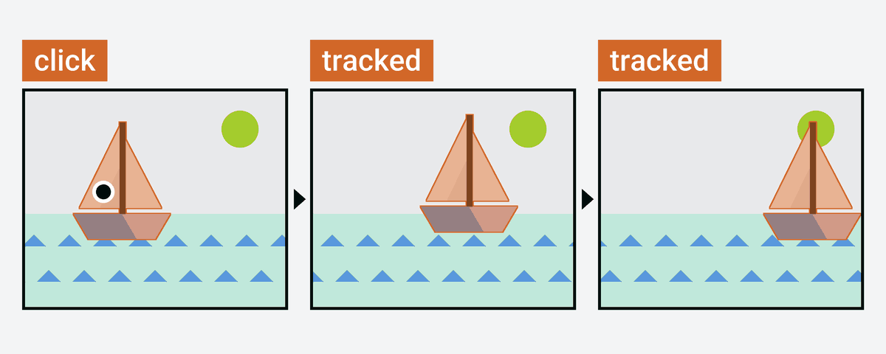

# EdgeTAM

## Overview

EdgeTAM, from Meta, follows one object through a video. Mark the object on the
first frame with a click or a box, and it returns the object's mask on every
frame. Use it to cut a moving object out of footage or to track a user-selected
item. Your application runs four components on each frame: an image encoder, a
memory attention that recalls earlier frames, a mask decoder that returns four
candidate masks, and a memory encoder that stores the chosen one.

## Inputs and outputs

### Inputs

One 1024×1024 RGB frame with ImageNet normalization.

- With Neat: pass each frame as an image, with stretch resizing and the ImageNet normalization preset.
- Yourself: stretch to 1024×1024 (bicubic), scale to 0–1, subtract (0.485, 0.456, 0.406), divide by (0.229, 0.224, 0.225).

### Between the components

On each frame:

1. Run `image_encoder` for `image_embeddings`, `high_res_features_0`, and `high_res_features_1`.
2. After the prompted frame, run `memory_attention` on `image_embeddings` and the memory bank. Its `conditioned_embeddings` replace the embeddings in step 3.
3. Run `mask_decoder` on the embeddings, both `high_res_features`, and the prompt. Prompt the first frame with a click, a click and a background click, or a box's two corners. `point_coords` holds (x + 0.5)/512 − 1 and (y + 0.5)/512 − 1, for x and y in 1024×1024 pixels. `point_types` is one-hot over padding, background, foreground, box top-left, and box bottom-right. Unused slots, and all slots on later frames, are padding.
4. Choose from `mask_logits` (1×256×256×4). With one point or none, take the best of masks 1 to 3 by `iou_scores` and its `object_pointers` row. With two points, take pointer 0 and mask 0, or the best of masks 1 to 3 if under 98% of mask 0's pixels above −0.05 are above 0.05.
5. If `object_score_logits` is 0 or below, set the mask to −1024.
6. Resize the mask bilinearly to 1024×1024. Threshold it at 0 on the prompted frame, else apply a sigmoid. Run `memory_encoder` on it and the frame's `image_embeddings`.

**Memory bank:** `memories` holds seven `memory_encoder` `memory` outputs: the prompted frame's, then the latest six, newest first. `object_pointers` holds sixteen chosen pointers in that order. `memory_mask` and `object_pointer_mask` are 1 for a filled slot, else 0.

### Outputs

The chosen mask, above 0 on the object. Neat has no decoder for it.

## Building applications

Run the package with the [Neat Model API](https://developer.sima.ai/software/develop-apps/development-workflow/model). For complete applications, start from the [Neat example apps](https://developer.sima.ai/examples).
