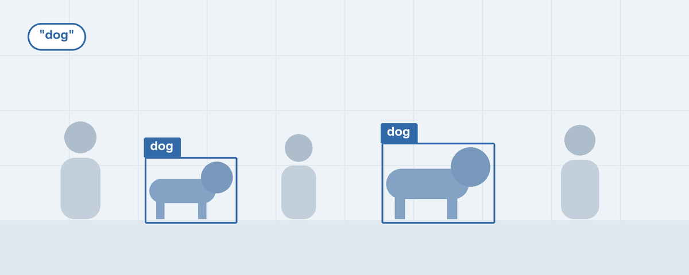

# EfficientSAM3 RepViT-M

## Overview

EfficientSAM3 RepViT-M finds and segments the objects that a short text prompt
names, such as "dog" or "traffic light". This package combines the fine-tuned
student's RepViT-M1.1 image trunk and neck with the Stage 1 SAM 3 text encoder,
fusion encoder, decoder and heads. It replaces the fine-tuned release's
MobileCLIP-S0 text encoder and reduces its 72×72 image token grid to 48×48.
It runs as two components: a text encoder, run once per prompt, and an image
model, run once per image and prompt. Your application packs the text features
on the CPU between them. Each image-model run returns 200 scored boxes, each
with a 192×192 mask.

## Inputs and outputs

**Prompt.** Use the package's `tokenizer/vocab.json` and `tokenizer/merges.txt`
with SAM 3's CLIP BPE cleaning and tokenization: the start token
49406, the prompt's tokens, and the end token 49407, at most 16 tokens in all.
Pass `token_one_hot`, a 16×49408 float tensor whose row i is one-hot for token
i, with the remaining rows zero.

**Between the components.** The text encoder returns `text_features`, 16×256.
Build the image model's `text` input, 17×256: rows 0–15 are the text features,
and row 16 holds 1 in its first n columns for the n prompt tokens, start and end
included, and 0 elsewhere. One text encoder run serves every image for that
prompt.

**Image.** Resize the RGB image to 1008×1008 with bilinear resampling, without
keeping the aspect ratio, and scale it to −1–1 with x / 127.5 − 1. Pass
`pixel_values` as a 1008×1008×3 (height, width, channel) float tensor.

**Outputs.** The image model returns `detections`, 200×6, and `mask_logits`,
192×192×200 (height, width, query).

1. Each detection row holds x1, y1, x2, y2 in 1008×1008 input pixels, the score, and 0.
2. The score is the query's probability times the image-level presence probability.
3. Scale the boxes by the original width and height divided by 1008.
4. Resize each query's mask bilinearly to the original image size and keep the pixels whose logit is positive.

## Building applications

Run the package with the [Neat Model
API](https://developer.sima.ai/software/develop-apps/development-workflow/model).
For complete applications, start from the [Neat example
apps](https://developer.sima.ai/examples).
