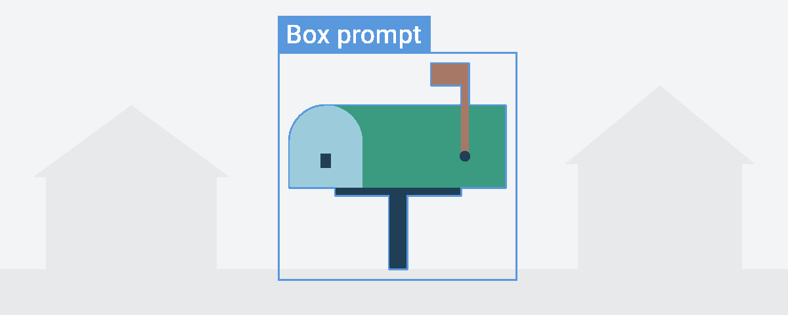

# EfficientSAM ViT-S

## Overview

EfficientSAM ViT-S is a lightweight Segment Anything model from Meta AI. Given an
image and a prompt, a box or a few clicked points, it returns a mask of the
object the prompt marks, with no fixed list of classes. It runs as two
components: an image encoder, which turns a 1024×1024 RGB image into an
embedding once per image, and a prompt decoder, which turns that embedding and
one prompt into three candidate masks with a predicted quality score for each.
Run the decoder again on the same embedding for each new prompt.

## Inputs and outputs

**Image input.** Resize the image straight to 1024×1024 without keeping its
aspect ratio, and scale the RGB values to 0–1. The encoder subtracts ImageNet's
mean and divides by its standard deviation itself. Pass its 1×256×64×64
`image_embeddings` to the prompt decoder as it is.

**Prompt input.** A prompt has up to 6 points: a box is its top-left and
bottom-right corners, and a click is a positive or a negative point. Pass them as
`points`, a 1×6×8 tensor with height, width, channel (HWC) axes, one row per
point. For a point (x, y) in a width×height image, a row holds
(x × 1024 / width + 0.5) / 1024 and (y × 1024 / height + 0.5) / 1024, then the
point's type as one-hot values in the order padding, negative point, positive
point, box top-left, box bottom-right, then 0. Fill the unused rows with
−0.5 / 1024 for both coordinates and the padding type.

**Outputs.** `low_res_masks` holds 3 candidate masks of 256×256 logits for the
stretched 1024×1024 image, and `iou_predictions` the predicted quality of each.
Neat returns `low_res_masks` with height, width, channel axes, as 1×256×256×3:
one channel per candidate mask.

1. Take the mask with the highest score in `iou_predictions`.
2. Resize its logits to the image's size with bilinear interpolation.
3. Keep the pixels whose logit is above 0.

## Building applications

Run the package with the [Neat Model API](https://developer.sima.ai/software/develop-apps/development-workflow/model). For complete applications, start from the [Neat example apps](https://developer.sima.ai/examples).
