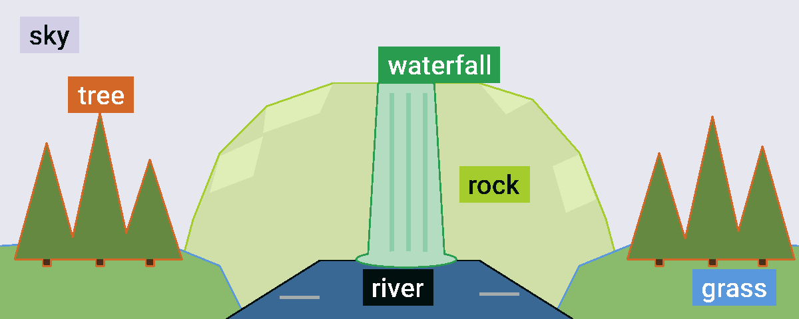

# FCN-HRNet-W18

## Overview

FCN-HRNet-W18 labels every pixel of a scene with a class, such as wall, floor,
sky, road, person, or car. Use it to find free floor for a robot, to separate
road, buildings, and sky in street views, or to cut out a background. The
application gets one class for each pixel, so two objects of the same class are
not told apart. It is trained on the 150 ADE20K scene classes. It predicts on a
grid at a quarter of the input resolution, so structures narrower than a grid
cell can disappear.

## Inputs

One 512×512×3 (height, width, channel) RGB image with values from 0 to 255, normalized per channel.

Preprocessing:

1. Stretch to 512×512 with bilinear resampling, without padding or cropping.
2. Subtract (123.675, 116.28, 103.53) and divide by (58.395, 57.12, 57.375), per channel, in RGB order.

## Outputs

| Output | Size | Holds |
| --- | --- | --- |
| `logits` | 128×128×150 (height, width, class) | 150 class scores for each cell of a 128×128 grid |

Postprocessing:

1. Resize `logits` bilinearly to the image's height and width.
2. At each pixel, take the class with the highest score.

Class index i is class i of the standard 150-class ADE20K scene-parsing order, from 0 wall, 1 building, 2 sky, and 3 floor to 149 flag.

## Building applications

Run the package with the [Neat Model
API](https://developer.sima.ai/software/develop-apps/development-workflow/model).
For complete applications, start from the [Neat example
apps](https://developer.sima.ai/examples).
