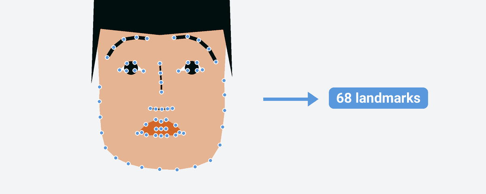

# FLD 68 Landmarks

## Overview

FLD 68 Landmarks finds the 68 standard facial landmarks on a face: the jaw line, eyebrows, nose, eyes and mouth,
numbered as in the iBUG 300-W scheme. It is ibug's Face Alignment Network with two stacked hourglasses, trained on
300W-LP. It takes one 256×256 RGB crop around a face that a face detector has found, and returns one heatmap per
landmark, which your application turns into point coordinates in the original image. The model runs as one
component.

## Inputs

One input, `image`: a 256×256×3 (height, width, channel) RGB face crop with values from 0 to 1.

Preprocessing, starting from a face box [left, top, right, bottom] from a face detector:

1. Take the box centre and its mean side length, and divide the side by 0.55.
2. Cut a square of that side around the centre, padding with zeros where it leaves the image.
3. Resize the square to 256×256, keep RGB order, and divide the pixel values by 255.

## Outputs

One output, `heatmaps`, with 68 heatmaps of 64×64, one per landmark.

Postprocessing:

1. In each heatmap, find the peak, and keep only the values within 6.4 heatmap pixels of it.
2. Clamp them at zero and take their centroid, counting each pixel at its centre (index + 0.5).
3. Scale the centroid by the crop's side over 64 and add the crop's top-left corner to get the point in the image.
4. The peak value is the point's confidence.

Heatmap index i is landmark i of the iBUG 68-point scheme: 0–16 jaw, 17–26 eyebrows, 27–35 nose, 36–47 eyes, 48–67 mouth.

## Building applications

Run the package with the [Neat Model
API](https://developer.sima.ai/software/develop-apps/development-workflow/model).
For complete applications, start from the [Neat example
apps](https://developer.sima.ai/examples).
