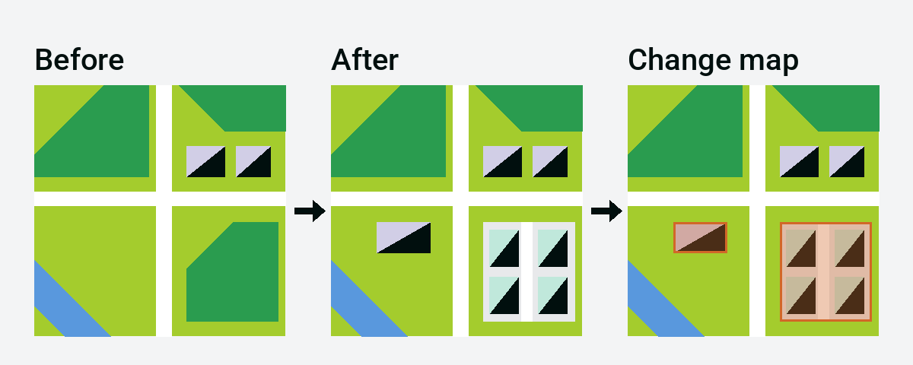

# FresUNet

## Overview

FresUNet finds where an area changed between two Sentinel-2 satellite images taken
on different dates, such as new buildings, roads or cleared land, for urban
monitoring and mapping. It takes both co-registered 13-band multispectral images
of the same area, stacked into one 26-channel 544 × 544 input, and returns a
change map: for every pixel, a score for no change and a score for change. It is a
residual encoder-decoder network that runs as a single component, trained on the
Onera Satellite Change Detection dataset.

## Inputs

One input, `new_input`: a 544×544×26 (height, width, channel) float tensor holding two co-registered 13-band Sentinel-2 images, each normalized by its own mean and standard deviation.

Preprocessing, for each date:

1. Read its 13 bands and bring the 20 m bands (B05, B06, B07, B8A, B11, B12) and 60 m bands (B01, B09, B10) to the 10 m grid of B04 by cubic-spline upsampling ×2 and ×6, cropping or edge-padding them to B04's size.
2. Stack the bands in the order B04, B03, B02, B08, B05, B06, B07, B8A, B11, B12, B01, B09, B10.
3. Subtract the image's mean and divide by its standard deviation, both taken over every band and pixel.
4. Resize to 544×544 with linear interpolation, smoothing first when shrinking.
5. Place the older date's 13 channels first, then the newer date's.

## Outputs

One output, `631`, 544×544×2: the log-probability of no change (channel 0) and change (channel 1) for each pixel.

Postprocessing:

1. For each pixel, take the channel with the higher value.
2. Channel 1 marks a changed pixel.
3. Resize the 544×544 change map back to the image's own size, with nearest-neighbour interpolation, to overlay it.

Channel 0 is no change and channel 1 is change.

## Building applications

Run the package with the [Neat Model API](https://developer.sima.ai/software/develop-apps/development-workflow/model). For complete applications, start from the [Neat example apps](https://developer.sima.ai/examples).
