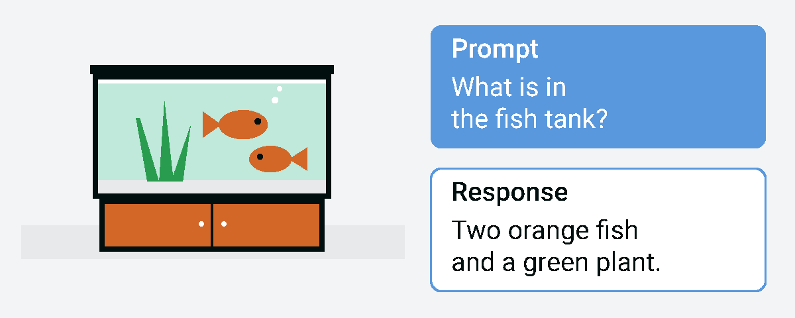

# Gemma 4 E2B

## Overview

Gemma 4 E2B is an instruction-tuned vision-language model from Google for answering questions about pictures, describing visual content, and holding text-based conversations. This package runs locally on SiMa.ai Modalix and accepts a text prompt with an optional image and conversation history. It generates a text response that applications can display as a complete answer or stream incrementally as tokens arrive.

*Image resolution and maximum context length can be changed when recompiling the model.*

## Inputs and outputs

1. Supply the question or instruction as `prompt`, with prior messages when continuing a conversation. Let the GenAI API apply the bundled chat template.
2. For an image request, decode `image` as RGB. Let the GenAI API apply the bundled processor settings for the 480 × 480 input; do not manually normalize pixels.
3. Read the generated `text` as a complete response or incremental tokens. Start a new conversation when previous messages should no longer influence the answer.

## Building applications

Run the package with the [Neat Model API](https://developer.sima.ai/software/develop-apps/development-workflow/model). For complete applications, start from the [Neat example apps](https://developer.sima.ai/examples).
