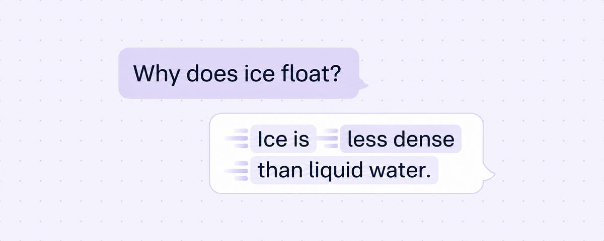

# Gemma 4 E2B Text MTP

## Overview

Gemma 4 E2B Text MTP is an instruction-tuned language model from Google for answering questions, summarizing documents, rewriting text, and continuing conversations. This language-only package runs locally on SiMa.ai Modalix and accepts a text prompt with optional conversation history. A small assistant proposes tokens that the target model checks before returning a text response. Applications can display a complete answer or stream accepted tokens as they arrive.

*Maximum context length can be changed when recompiling the model.*

## Inputs and outputs

1. Keep the target and assistant folders together when loading the package; the GenAI API manages their speculative decoding.
2. Supply the question or instruction as `prompt`, including relevant source text and prior messages when continuing a conversation. Let the GenAI API apply the bundled chat template.
3. Read the generated `text` as a complete response or incremental tokens.
4. Start a new conversation when previous messages should no longer influence the answer.

## Building applications

Run the package with the [Neat Model API](https://developer.sima.ai/software/develop-apps/development-workflow/model). For complete applications, start from the [Neat example apps](https://developer.sima.ai/examples).
