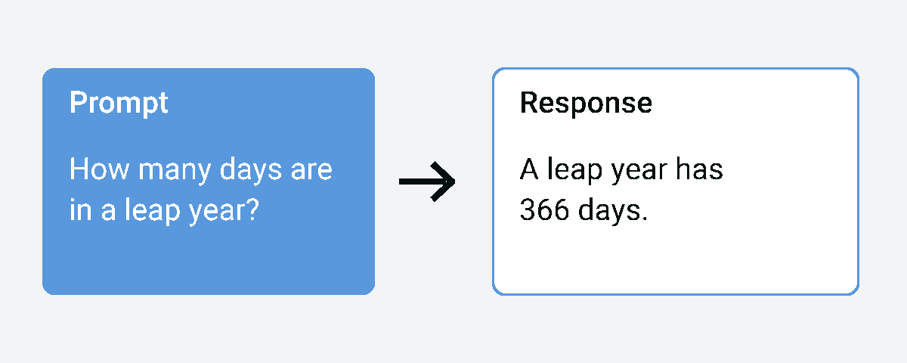

# Gemma 4 E4B Text

## Overview

Gemma 4 E4B Text answers questions, summarizes documents, rewrites text, and
holds a conversation. Use it for a chat assistant, document summaries, or
pulling facts out of text. Your application sends a prompt and gets the answer
back as text, complete or streamed as it is generated. This variant accepts no
images. It is the E4B size of the Gemma 4 family from Google.

*Maximum context length can be changed when recompiling the model.*

## Inputs

One text prompt, with the earlier messages when you continue a conversation.

- `prompt`: the question or instruction, with any source text it refers to. The package applies its bundled chat template to the prompt.
- Earlier messages: pass them to continue a conversation. Start a new conversation when they should no longer influence the answer.

## Outputs

The answer as text.

- `text`: the generated answer, as one complete response.
- Streaming: read incremental tokens as they arrive instead of waiting for the complete response.

## Building applications

Run the package with the [Neat GenAI Model API](https://developer.sima.ai/software/develop-apps/development-workflow/genai-model). For complete applications, start from the [Neat example apps](https://developer.sima.ai/examples).
