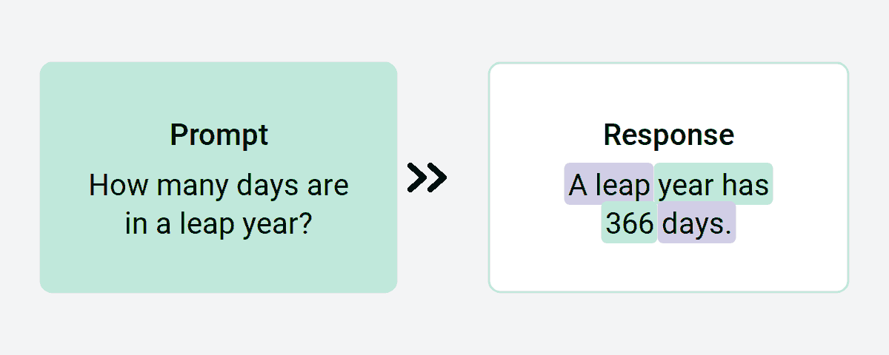

# Gemma 4 E4B Text MTP

## Overview

Gemma 4 E4B Text MTP combines an instruction-tuned language model from Google with a small MTP assistant for answering questions, rewriting text, extracting information, and continuing conversations. The package runs locally on SiMa.ai Modalix and accepts text prompts with optional conversation history. The assistant proposes tokens that the target model checks before returning a text response. Applications can display a complete answer or stream accepted tokens as they arrive.

*Maximum context length can be changed when recompiling the model.*

## Inputs and outputs

1. Keep the target and assistant folders together when loading the package; the GenAI API manages their speculative decoding.
2. Supply the question or instruction as `prompt`, with prior messages when continuing a conversation. Let the GenAI API apply the bundled chat template.
3. Read the generated `text` as a complete response or incremental tokens. Start a new conversation when previous messages should no longer influence the answer.

## Building applications

Run the package with the [Neat GenAI Model API](https://developer.sima.ai/software/develop-apps/development-workflow/genai-model). For complete applications, start from the [Neat example apps](https://developer.sima.ai/examples).
