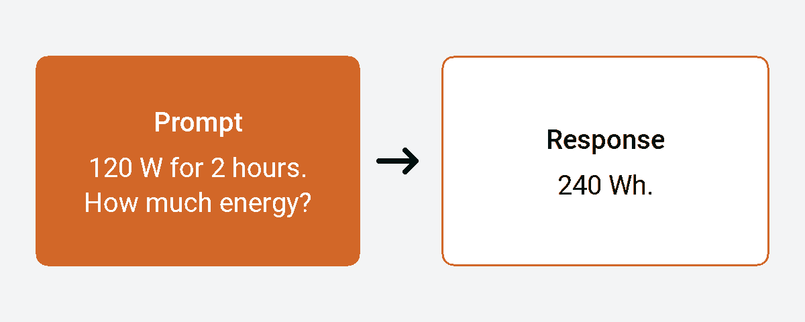

# GPT-OSS 20B

## Overview

GPT-OSS 20B is an open-weight reasoning language model from OpenAI for answering questions, following instructions, and working through multi-step problems. This language-only package runs locally on SiMa.ai Modalix and accepts a text prompt with optional conversation history. It generates a text response that applications can display as a complete answer or stream incrementally as tokens arrive.

*Maximum context length can be changed when recompiling the model.*

## Inputs and outputs

1. Supply the question or instruction as `prompt`, including relevant source text and prior messages when continuing a conversation. Let the GenAI API apply the bundled chat template.
2. Read the generated `text` as a complete response or incremental tokens.
3. Start a new conversation when previous messages should no longer influence the answer.

## Building applications

Run the package with the [Neat GenAI Model API](https://developer.sima.ai/software/develop-apps/development-workflow/genai-model). For complete applications, start from the [Neat example apps](https://developer.sima.ai/examples).
