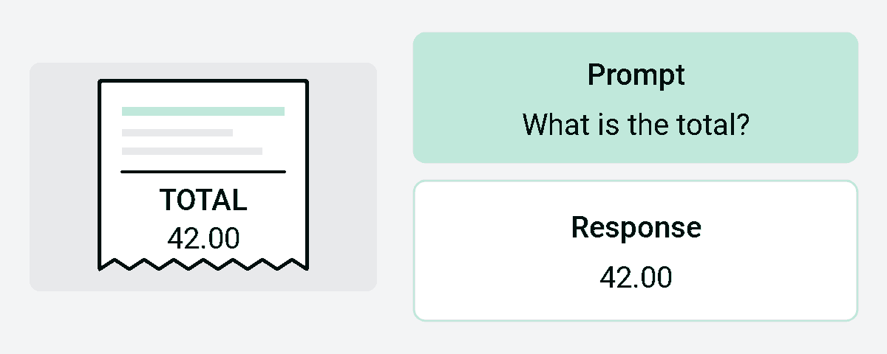

# LFM2.5-VL-1.6B

## Overview

LFM2.5-VL-1.6B is a compact vision-language model from Liquid AI for answering questions about images, describing visual content, and holding text-based conversations. This package runs locally on SiMa.ai Modalix and supports both text-only and image-plus-text requests. It generates a text response that applications can display as a complete answer or stream incrementally as tokens arrive.

*Image resolution and maximum context length can be changed when recompiling the model.*

## Inputs and outputs

1. Supply the question or instruction as `prompt`, including relevant source text and prior messages when continuing a conversation. Let the GenAI API apply the bundled chat template.
2. For an image request, decode `image` as RGB. Let the GenAI API apply the bundled processor settings for the 512 × 512 input; do not manually normalize pixels.
3. Read the generated `text` as a complete response or incremental tokens. Start a new conversation when previous messages should no longer influence the answer.

## Building applications

Run the package with the [Neat GenAI Model API](https://developer.sima.ai/software/develop-apps/development-workflow/genai-model). For complete applications, start from the [Neat example apps](https://developer.sima.ai/examples).
