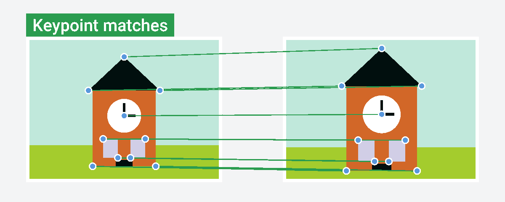

# LightGlue (SuperPoint)

## Overview

LightGlue is a feature matcher from ETH Zurich. Given the SuperPoint keypoints
and descriptors of two images, it finds which keypoints show the same point of
the scene, for uses such as relative pose estimation, image stitching and 3D
reconstruction. It runs as one component on 512 keypoints per image and
returns a soft assignment between the two images' keypoints, from which the
CPU extracts the matches. The package holds the matcher only: run SuperPoint,
which this package does not include, to find the keypoints first.

## Inputs and outputs

**Input.** Run SuperPoint on each image stretched to 640×480 and keep its 512
highest-scoring keypoints, with a score threshold of 0.0005, suppression within
4 pixels and no keypoints within 4 pixels of an edge. Neat's SuperPoint decoder
uses these settings with its `LightGlueV1` profile. The model has no padding
mask, so skip an image with fewer than 512 keypoints: placeholder rows would
change the real keypoints' matches. Pass four inputs, in this order:

1. `encoding0`, 1×512×128: each keypoint's position encoding, computed on the CPU. Normalize its pixel coordinates as (x − 320) / 320 and (y − 240) / 320, multiply by LightGlue's 32×2 keypoint projection, the checkpoint's `positional_encoder.projector.weight`, to get 32 phases, repeat each phase twice, and pass the 64 cosines followed by the 64 sines.
2. `descriptors0`, 1×512×256: SuperPoint's unit-length descriptors, in the same order.
3. `encoding1` and `descriptors1`: the same for the second image.

**Outputs.** `assignment` is 1×512×512: the probability that keypoint i of the
first image and keypoint j of the second show the same point.

1. For each keypoint i, take the keypoint j with the highest assignment in row i.
2. Keep the pair when i is also the highest in column j, and its assignment is above 0.1.

## Building applications

Run the package with the [Neat Model API](https://developer.sima.ai/software/develop-apps/development-workflow/model). For complete applications, start from the [Neat example apps](https://developer.sima.ai/examples).
