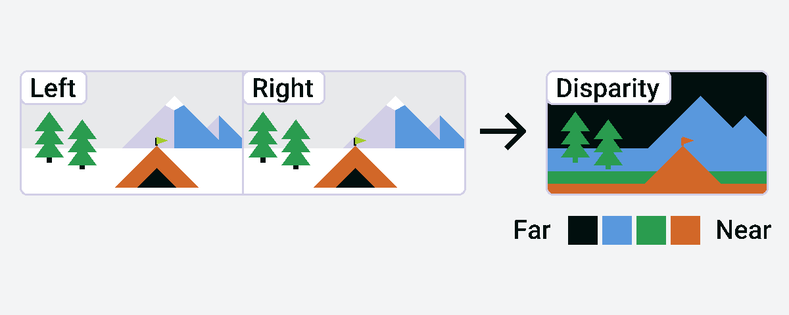

# LightStereo-L

## Overview

LightStereo-L is the large LightStereo stereo-matching model from OpenStereo,
trained on the synthetic Scene Flow dataset. It takes one frame holding the left
and right images of a rectified stereo camera pair side by side and returns a
disparity map for the left image: for each pixel, how many pixels to the left
the same point appears in the right image; nearer surfaces have larger
disparity. The model runs as one component and covers disparities up to 188
pixels.

## Inputs and outputs

**Input.** One RGB frame, `stereo`, of 1920×540 with a rectified pair side by
side: the left image in the left half, the right image in the right half, and a
scene point on the same row in both. The model pads each image to 960×544 itself,
as the original evaluation does. Prepare the frame either way:

1. With Neat: pass the frame as an RGB image with stretch resizing and the ImageNet normalization preset.
2. Yourself: scale RGB to 0–1, subtract the ImageNet mean (0.485, 0.456, 0.406), divide by the standard deviation (0.229, 0.224, 0.225), and pass a 540×1920×3 float tensor with Neat's preprocessing off.

**Outputs.** `disparity` holds one value per pixel of the 960×540 left image, in
pixels, from 0 to 188.

1. If Neat resized a frame of another size, resize the map to your left image and multiply each value by its width divided by 960.
2. A pixel at column x with disparity d matches column x − d of the same row in the right image.
3. For d above 0, depth equals the focal length in pixels times the baseline, divided by d.
4. Treat disparities near 0 as too far away to measure.

No Neat decoder handles this output.

## Building applications

Run the package with the [Neat Model API](https://developer.sima.ai/software/develop-apps/development-workflow/model).
For complete applications, start from the [Neat example apps](https://developer.sima.ai/examples).
