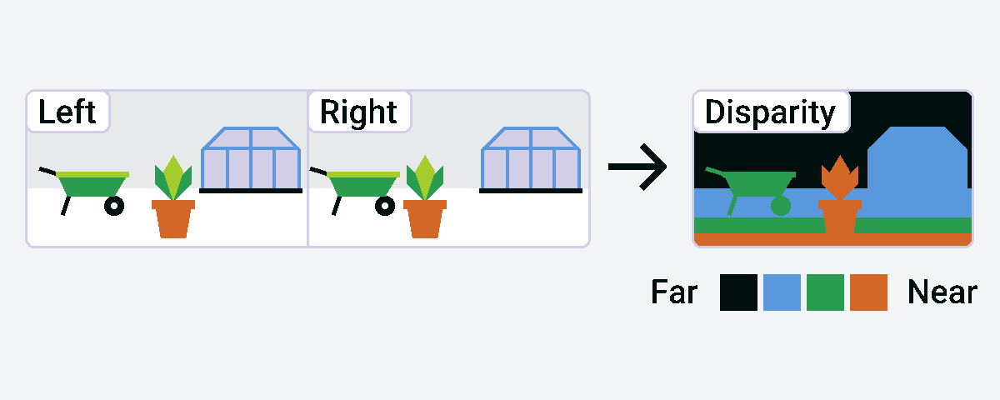

# LightStereo-M

## Overview

LightStereo-M uses the two images of a stereo camera to estimate how far away
each pixel is. Use it for obstacle avoidance, 3D measurement, and navigation.
It returns a disparity map for the left image: for each pixel, how many pixels
to the left the same point appears in the right image. Nearer surfaces have
larger disparity, and your application turns disparity into distance with the
camera's focal length and baseline. The pair must be rectified and passed side
by side in one frame. It covers disparities up to 188 pixels and was trained on
the synthetic Scene Flow dataset. It is the middle one of the three LightStereo
sizes from OpenStereo.

## Inputs

One 1920×540 RGB frame, `stereo`, normalized with the ImageNet mean and standard deviation. It holds a rectified pair side by side: the left image in the left half, the right image in the right half, and each scene point on the same row in both.

- With Neat: pass the frame as an image, with stretch resizing and the ImageNet normalization preset.
- Yourself: scale RGB to 0–1, subtract (0.485, 0.456, 0.406), divide by (0.229, 0.224, 0.225), and pass a 540×1920×3 (height, width, channel) float tensor with Neat's preprocessing off.

The model pads each image to 960×544 itself.

## Outputs

A disparity map for the left image. Neat has no decoder for it. `disparity` holds one value per pixel of the 960×540 left image, in pixels, from 0 to 188.

1. If Neat resized a frame of another size, resize the map to your left image and multiply each value by its width divided by 960.
2. A pixel at column x with disparity d matches column x − d of the same row in the right image.
3. For d above 0, depth equals the focal length in pixels times the baseline, divided by d.
4. Treat disparities near 0 as too far away to measure.

## Building applications

Run the package with the [Neat Model API](https://developer.sima.ai/software/develop-apps/development-workflow/model).
For complete applications, start from the [Neat example apps](https://developer.sima.ai/examples).
