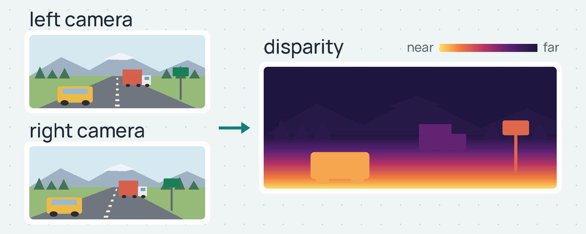

# LightStereo-S

## Overview

LightStereo-S is the smallest model of the LightStereo stereo-matching family
from OpenStereo, trained on the synthetic Scene Flow dataset. It takes the left
and right images of a rectified stereo camera pair and returns a disparity map
at the input resolution: for each pixel of the left image, how many pixels to
the left the same point appears in the right image. Nearer surfaces have larger
disparity, so your application converts disparity to depth with the camera's
focal length and baseline. The model runs as one component and covers
disparities up to 188 pixels.

## Inputs and outputs

**Input.** Two images, `left` and `right`, from a rectified stereo pair: a scene
point appears on the same row in both. Each image must be at most 544 rows by
960 columns: scale larger images down, then divide the disparities by the same
factor. Pad each image to 544×960 by repeating its top row above it and its
rightmost column to its right. Scale the RGB values to
0–1, subtract the ImageNet mean (0.485, 0.456, 0.406), and divide by the
standard deviation (0.229, 0.224, 0.225). The reference scripts pass each image
as a 544×960×3 (height, width, channel) float tensor, with Neat's resize, color
conversion, and normalization turned off.

**Outputs.** `disparity` holds one value per pixel of the padded left image, in
pixels, from 0 to 188.

1. Remove the rows added above the image and the columns added to its right.
2. A pixel at column x with disparity d matches column x − d of the same row in the right image.
3. For d above 0, depth equals the focal length in pixels times the baseline, divided by d.
4. Treat disparities near 0 as too far away to measure.

No Neat decoder handles this output; the application converts it directly.

## Building applications

Run the package with the [Neat Model API](https://developer.sima.ai/software/develop-apps/development-workflow/model).
For complete applications, start from the [Neat example apps](https://developer.sima.ai/examples).
