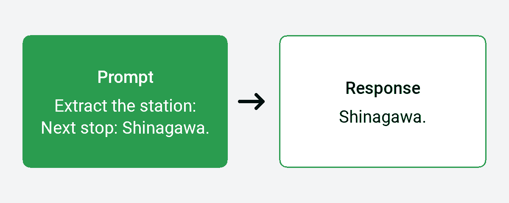

# Llama 3.1 Swallow 8B Instruct v0.5

## Overview

Llama 3.1 Swallow 8B Instruct v0.5 answers questions, rewrites text, extracts
information, and holds a conversation. Use it for a chat assistant, a writing
aid, or pulling facts out of text, in Japanese or English. Your application
sends a prompt and gets the answer back as text, complete or streamed as it is
generated. It comes from the Swallow team, which built it on Meta's Llama 3.1
with additional training for Japanese and English.

*Maximum context length can be changed when recompiling the model.*

## Inputs

One text prompt, with the earlier messages when you continue a conversation.

- `prompt`: the question or instruction, with any source text it refers to. Let the GenAI API apply the bundled chat template.
- Earlier messages: pass them to continue a conversation. Start a new conversation when they should no longer influence the answer.

## Outputs

The answer as text.

- `text`: the generated answer, as one complete response.
- Streaming: read incremental tokens as they arrive instead of waiting for the complete response.

## Building applications

Run the package with the [Neat GenAI Model API](https://developer.sima.ai/software/develop-apps/development-workflow/genai-model). For complete applications, start from the [Neat example apps](https://developer.sima.ai/examples).
