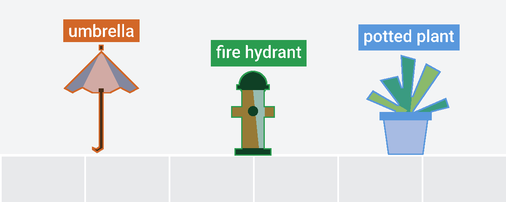

# Mask2Former Swin-T COCO

## Overview

Mask2Former finds every object of the 80 COCO classes in an image and returns
each one's class and pixel mask. It is a masked-attention transformer with a
Swin-T backbone: 100 learned queries each predict one object, attending only
inside the mask they predicted at the previous step. It takes a 384×384 RGB
image and runs as sixteen components: the backbone as `backbone_0` and
`backbone_1`, the pixel decoder as `pixel_decoder_0` to `pixel_decoder_12`, and
the `transformer_decoder`. The CPU only prepares the image and decodes the
instances. Build: `w16a16` (BF16).

## Inputs

One input to `backbone_0`, `image`: a 384×384×3 (height, width, channel) RGB image, normalized with the ImageNet mean and standard deviation on the 0 to 255 scale.

Preprocessing:

1. Stretch the image to 384×384 with bilinear resampling.
2. Subtract (123.675, 116.28, 103.53) and divide by (58.395, 57.12, 57.375), per channel.

## Between the components

Each input is the earlier output of the same name, passed on unchanged.

1. `backbone_0` returns `features0`, `features1` and `stage3_input`.
2. `backbone_1` takes `stage3_input` and returns `features2` and `features3`.
3. `pixel_decoder_0` takes `features1` to `features3` and returns `embedded` and `partial0`.
4. Each attention layer `i` runs as two components: `pixel_decoder_{2i}` returns `partial{i}`, and `pixel_decoder_{2i+1}` takes the layer's input tokens and `partial{i}` and returns `tokens{i}`.
5. `pixel_decoder_12` takes `tokens5` and `features0` and returns `mask_features`.
6. The `transformer_decoder` takes `mask_features` and `tokens5`.

## Outputs

| Output | Size | Holds |
|---|---|---|
| `class_logits` | 81 channels by 100 queries | logits over the 80 COCO classes and a final "no object" class, per query |
| `mask_logits` | 100 masks of 96×96 | mask logits on a grid covering the input, per query |

Postprocessing:

1. Apply a softmax over each query's 81 logits and drop "no object".
2. Keep the 100 highest (query, class) probabilities.
3. Upsample each kept query's mask bilinearly to 384×384, resize it to the image and threshold at 0.
4. Score each instance as its class probability times the mean sigmoid of its mask logits inside the mask.

Class index `i` is the `i`-th COCO category in increasing category ID order (0 is person, 79 is toothbrush).

## Building applications

Run the package with the [Neat Model
API](https://developer.sima.ai/software/develop-apps/development-workflow/model).
For complete applications, start from the [Neat example
apps](https://developer.sima.ai/examples).
