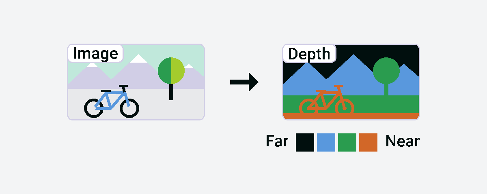

# MiDaS v2.1 Small

## Overview

MiDaS v2.1 Small estimates how far away every pixel of an image is, from a
single camera and without a depth sensor. Use it for obstacle avoidance, for
separating foreground from background, or for 3D effects. It returns a depth map
where larger values are closer. The depth is relative: the values have an
unknown scale and offset, so your application aligns them to real distances when
it needs them.

## Inputs

One 256×256×3 (height, width, channel) RGB image, normalized with the ImageNet mean and standard deviation.

Preprocessing:

1. Divide by 255.
2. Resize to 256×256 with bicubic resampling, without keeping the aspect ratio.
3. Subtract (0.485, 0.456, 0.406) and divide by (0.229, 0.224, 0.225).

## Outputs

`predicted_depth` holds 256×256 values of relative inverse depth, where larger is closer.

Postprocessing:

1. Resize `predicted_depth` to your image's resolution with bicubic interpolation.
2. For a relative depth view, use the values directly.
3. For metric depth, fit a scale s and an offset t so that s × value + t matches 1 / distance at points of known distance, such as from a depth sensor.
4. Take each pixel's distance as 1 / (s × value + t), capped at the farthest distance your scene can contain.

## Building applications

Run the package with the [Neat Model
API](https://developer.sima.ai/software/develop-apps/development-workflow/model).
For complete applications, start from the [Neat example
apps](https://developer.sima.ai/examples).
