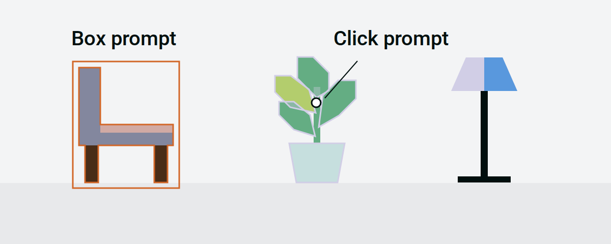

# MobileSAM

## Overview

MobileSAM turns clicks or boxes into object masks using a TinyViT image encoder distilled from Segment Anything. The package runs as two components: the whole `image_encoder` prepares an image embedding, then `prompt_decoder` predicts masks for each prompt. Run the encoder once per image and reuse the embedding for subsequent prompts. You supply foreground or background clicks, box corners, or a combination; mask prompts are not supported.

## Inputs

One 1024×1024×3 (height, width, channel) RGB `image` for `image_encoder`.

Preprocessing:

1. Letterbox the image into the top-left corner of 1024×1024 with antialiased bilinear resampling: scale its longer side to 1024, round the shorter side to the nearest pixel, and pad the rest with 116.
2. Subtract (123.675, 116.28, 103.53) from the 0–255 pixels and divide by (58.395, 57.12, 57.375), rounding to nearest even.

## Between the components

1. Run `image_encoder` once per image and keep its `image_embeddings`, 256 channels on a 64×64 grid. Pass them to `prompt_decoder` for each prompt; do not rerun the encoder while the image is unchanged.
2. Prepare up to five points with `prompt_inputs` and `PromptEncoding` in `scripts/pipeline.py`, loading the package's `prompt-encoding.json` once. The CPU computes `point_encoding`, 256 float32 channels for six slots. `point_types` has five one-hot channels: padding, background, foreground, box top-left and box bottom-right. A prompt without a box includes one padding token; unused slots are zero and excluded from attention.

## Outputs

`masks`, four 256×256 logit maps, and `iou_predictions`, their predicted quality. Masks carry no class labels.

Postprocessing:

1. Take mask 0 for a box or several clicks. For one click, take the mask among 1 to 3 with the highest `iou_predictions`.
2. Resize it bilinearly to 1024×1024, crop the letterboxed image's top-left area, and resize that bilinearly to the image's size.
3. Pixels above 0 belong to the object.

`pipeline.preprocess` and `pipeline.image_mask` do the same preparation and resizing on the CPU with Pillow and OpenCV.

## Building applications

Run the package with the [Neat Model API](https://developer.sima.ai/software/develop-apps/development-workflow/model). For complete applications, start from the [Neat example apps](https://developer.sima.ai/examples).
