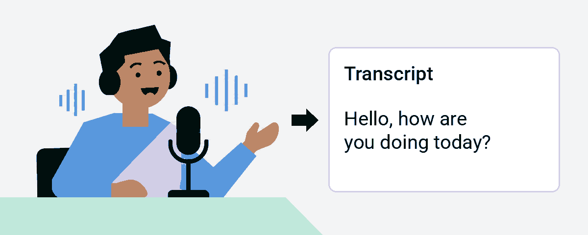

# Nemotron 3.5 ASR Streaming 0.6B

## Overview

Nemotron 3.5 ASR Streaming turns speech into text as it arrives, for live captions, voice interfaces, and dictation. It recognizes many languages, chosen with a language prompt or detected automatically, and returns punctuated text that grows with each 560 ms of audio. The package holds one compiled encoder and two small CPU models that turn its output into text. The encoder keeps a memory of earlier audio between calls, so feed each recording in order and start every new recording from an empty memory.

## Inputs

One 560 ms chunk of 16 kHz mono audio with 480 ms lookahead, as 128-bin log-mel features, plus a language prompt and the memory the previous call returned.

Preprocessing:

1. Apply preemphasis 0.97, then a 512-point transform with a 400-sample symmetric Hann window and a 160-sample hop, using the filters and window in `frontend.npz`.
2. Take the log of the 128 mel energies.
3. Pass 49 feature frames on a recording's first call and 56 on later calls.
4. Select the language prompt from `processor_config.json`; `auto` detects the language.
5. On a recording's first call, set every memory input to zero.

## Outputs

| Output | Size | Holds |
| --- | --- | --- |
| `encoded` | 7×640 | One row of 640 values per 80 ms of audio, for the decoder |
| `sub/next_sub1`, `sub/next_sub2`, and each layer's `next_keys`, `next_values`, `next_conv` | As their inputs | The memory for the next call |

Postprocessing:

1. Pass each memory output back as the matching input of the next call.
2. For each row of `encoded`, run `joiner_cpu_int8.onnx` until it returns blank, token 13087.
3. After each other token, run `predictor_cpu_int8.onnx` on it with `hidden` and `cell`, and keep `prediction`, `next_hidden`, and `next_cell`.
4. Turn the tokens into text with `tokenizer.json`.

## Building applications

Run the package with the [Neat Model API](https://developer.sima.ai/software/develop-apps/development-workflow/model). For complete applications, start from the [Neat example apps](https://developer.sima.ai/examples).
