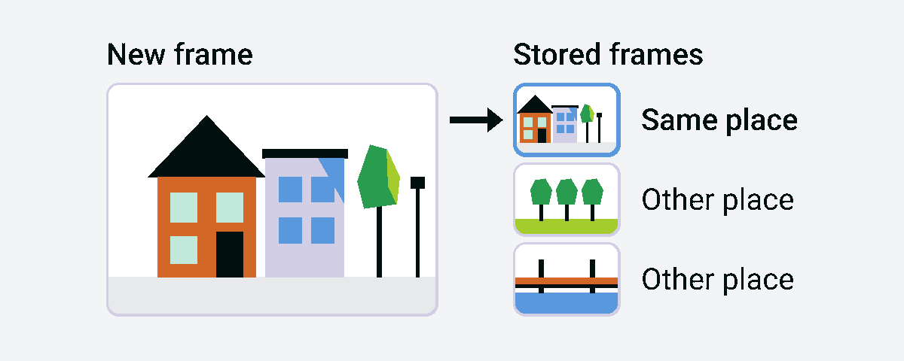

# NetVLAD

## Overview

NetVLAD turns an image of a place into one descriptor, a list of 4,096 numbers,
so that two views of the same place get similar descriptors. Use it for visual
place recognition and loop closure, where a robot or vehicle notices that it has
returned to a place it mapped before. Your application compares the descriptor
of each new frame with those of stored keyframes. The closest ones are candidate
revisits. It confirms each one by matching local features between the two images
before it corrects its map. The weights come from Patch-NetVLAD and were trained
on Pittsburgh street-view images.

## Inputs and outputs

### Inputs

One RGB image 640 wide by 480 high, normalized with the ImageNet mean and standard deviation.

- With Neat: pass your frame as an image, with stretch resizing and the ImageNet normalization preset.
- Yourself: resize to 640 wide by 480 high with bilinear resampling, without cropping or padding. Scale to 0–1, subtract (0.485, 0.456, 0.406), divide by (0.229, 0.224, 0.225), and pass a 480×640×3 (height, width, channel) float tensor with Neat's resize, color conversion, and normalization off.

### Outputs

One place descriptor. Neat has no decoder for it; your application compares descriptors itself.

| Tensor | Size | Holds |
|---|---|---|
| `descriptor` | 4,096 values | the place descriptor, with a length (L2 norm) of 1 |

1. Store the descriptor of each keyframe in a nearest-neighbor index.
2. For a new frame, take the dot product with each stored descriptor. For unit vectors it equals the cosine similarity, and a larger value means a more similar place.
3. Skip the most recent keyframes, which always look alike, and keep the best matches above a similarity threshold tuned on your own route.
4. Confirm each candidate with local feature matching and geometric verification before adding a loop-closure constraint.

The descriptor needs no further normalization, and the output has no classes.

## Building applications

Run the package with the [Neat Model
API](https://developer.sima.ai/software/develop-apps/development-workflow/model).
For complete applications, start from the [Neat example
apps](https://developer.sima.ai/examples).
