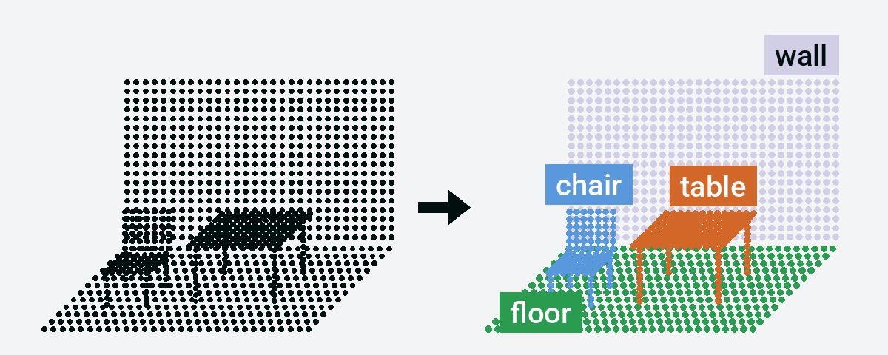

# PointNet++ SSG S3DIS

## Overview

PointNet++ SSG S3DIS labels every point of an indoor 3D scan as one of 13
classes, such as wall, floor, chair, or table. It scores every class for each
point of a 4096-point block. Four set-abstraction components summarize ever
fewer points, and four feature-propagation components carry the summaries back
to every point; your application groups and interpolates points between them.

## Inputs

One input to `sa1`: a block of 4096 points with 9 values each.

Preprocessing:

1. Shift the scan so its minimum is 0.
2. Fill 4096-point blocks with the points of 1 m × 1 m columns taken every 0.5 m, repeating random points to fill.
3. Give each point 9 values: x and y minus the column center, z; RGB / 255; and x, y, z divided by the scan's maximum.

## Between the components

Once per block, from the first three values:

1. Farthest point sampling: from point 0, keep the point farthest from those kept, to 1024 points, then 256, 64, and 16.
2. Ball query: for each kept point, take the 32 lowest-numbered previous-level points within 0.1, 0.2, 0.4, or 0.8 m, repeating the first to fill.
3. Interpolation: take each point's 3 nearest points one level coarser, weighted by 1 / (squared distance + 1e-8) and normalized.
4. Feed `sa1` to `sa4` 1 × (C + 3) × S × 32: each kept point's 32 neighbours' features (the 9 inputs, then the previous output), then their offsets from it.
5. Feed `fp4` to `fp1` 1 × (C + C_skip) × N × 1: interpolated features, then the matching set-abstraction output (none for `fp1`).

## Outputs

One output, `fp1_output`, 1 × 13 × 4096 × 1: a score per class and point.

Postprocessing:

1. Take each point's highest-scoring class.
2. For a scan, keep each point's most frequent label over its blocks.

The classes: 0 ceiling, 1 floor, 2 wall, 3 beam, 4 column, 5 window, 6 door, 7 chair, 8 table, 9 bookcase, 10 sofa, 11 board, 12 clutter.

## Building applications

Run the package with the [Neat Model API](https://developer.sima.ai/software/develop-apps/development-workflow/model). For complete applications, start from the [Neat example apps](https://developer.sima.ai/examples).
