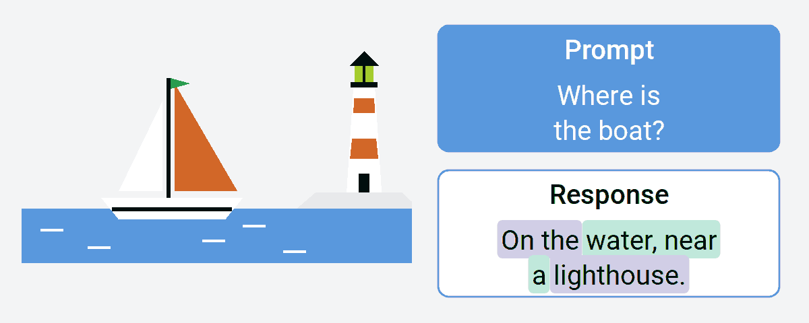

# Qwen3.5-4B DFlash

## Overview

Qwen3.5-4B DFlash answers questions about an image, describes what it shows, and
holds a text conversation. Use it to caption images, answer questions about a
camera frame, or chat about a picture. Your application sends a prompt, with or
without an image, and gets the answer back as text, complete or streamed as it
is generated. This variant speeds up generation: a small DFlash assistant model
in the package proposes tokens and the main model checks each one. It comes from
Alibaba Cloud.

*Image resolution and maximum context length can be changed when recompiling the model.*

## Inputs

One text prompt, an optional image, and the earlier messages when you continue a conversation.

- Package: keep the target (main model) and assistant folders together when you load it.
- `prompt`: the question or instruction, with any source text it refers to. The package applies its bundled chat template to the prompt.
- `image`: for an image request, an image decoded as RGB. The package prepares it for the 448×448 input with its bundled processor. Do not normalize the pixels yourself.
- Earlier messages: pass them to continue a conversation. Start a new conversation when they should no longer influence the answer.

## Outputs

The answer as text.

- `text`: the generated answer, as one complete response.
- Streaming: read incremental tokens as the main model accepts them instead of waiting for the complete response.

## Building applications

Run the package with the [Neat GenAI Model API](https://developer.sima.ai/software/develop-apps/development-workflow/genai-model). For complete applications, start from the [Neat example apps](https://developer.sima.ai/examples).
