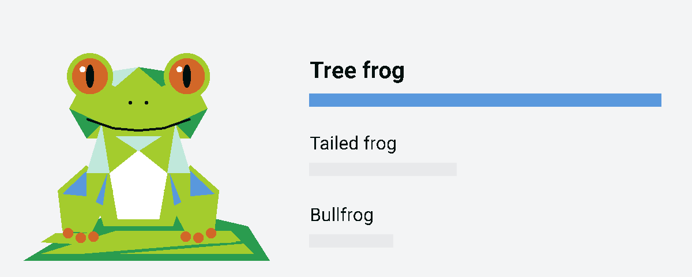

# ResNet-34

## Overview

ResNet-34 sorts an image into one of the 1,000 ImageNet classes, such as
animals, vehicles, and household objects. Use it to tag or sort photos, or to
check what a camera is looking at. It returns one score for each class, and your
application reports the most likely ones. It names the main subject of the image
and does not locate it. The package uses torchvision's ImageNet weights
(IMAGENET1K_V1).

## Inputs

One 224×224×3 (height, width, channel) RGB image, normalized with the ImageNet mean and standard deviation.

Preprocessing:

1. Resize with bilinear resampling so the shorter side is 256.
2. Crop the center 224×224.
3. Divide by 255.
4. Subtract (0.485, 0.456, 0.406) from the red, green, and blue channels.
5. Divide them by (0.229, 0.224, 0.225).

## Outputs

One output, `logits`, with one score for each of the 1,000 classes.

Postprocessing:

1. Apply a softmax to `logits` to get class probabilities.
2. Take the highest probability as the class, or the five highest as the top-5 classes.

Class index i is the i-th ImageNet-1k WordNet ID in sorted order, which is the standard ImageNet-1k class order.

## Building applications

Run the package with the [Neat Model
API](https://developer.sima.ai/software/develop-apps/development-workflow/model).
For complete applications, start from the [Neat example
apps](https://developer.sima.ai/examples).
