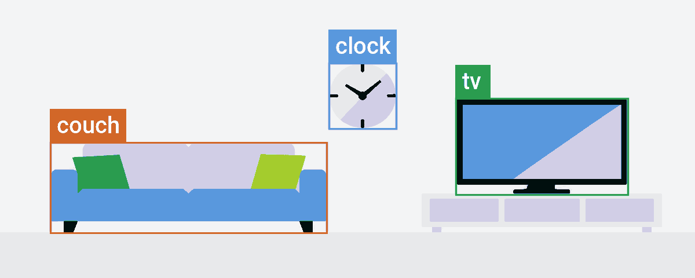

# RF-DETR Medium

## Overview

RF-DETR Medium finds everyday objects in an image and returns a box, a class,
and a score for each. Use it to count, track, or monitor objects in camera
streams. It knows the COCO classes. It is the Medium size of Roboflow's RF-DETR
detector. The larger sizes are more accurate and slower. The model runs in two
parts, and your application picks the 300 best candidate boxes on the CPU
between them. Each object is predicted once, so there are no overlapping boxes
to remove.

## Inputs

One 576×576 RGB image, normalized with the ImageNet mean and standard deviation.

- With Neat: pass your frame as an image, with stretch resizing and the ImageNet normalization preset.
- Yourself: stretch to 576×576 with bilinear resampling. Scale to 0–1, subtract (0.485, 0.456, 0.406), divide by (0.229, 0.224, 0.225), and pass a 576×576×3 (height, width, channel) float tensor with Neat's preprocessing off.

## Between the components

The backbone returns `backbone_features`, `proposal_scores`, and `proposal_boxes`, with 1,296 proposals.

1. Take the 300 highest scores, breaking ties by the lower proposal index.
2. Gather their boxes in that order and pass them as `proposals`, with `backbone_features`, to the decoder. Keep the order, because the decoder treats each position differently.

## Outputs

Up to 300 detections, each a box, a class index, and a score. Neat has no decoder for this model, so decode these tensors.

| Tensor | Size | Holds |
|---|---|---|
| `dets` | 300 rows of 4 values | boxes as (cx, cy, w, h), fractions of the image |
| `labels` | 300 rows of 91 values | class logits per box |

1. Apply a sigmoid to `labels` and rank all 300×91 box-class pairs by score.
2. Keep the 300 best pairs, then drop those with an unused class index.
3. The corners are (cx - w/2, cy - h/2) and (cx + w/2, cy + h/2). Multiply x by the image width and y by the image height, and clip to the image.

Class index i is COCO category ID i. Eleven of the 91 indexes are unused.

## Building applications

Run the package with the [Neat Model
API](https://developer.sima.ai/software/develop-apps/development-workflow/model).
For complete applications, start from the [Neat example
apps](https://developer.sima.ai/examples).
