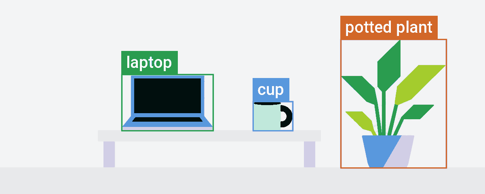

# RF-DETR Nano

## Overview

RF-DETR Nano finds everyday objects in an image and returns a box, a class, and
a score for each. Use it to count, track, or monitor objects in camera streams.
It knows the COCO classes. It is the Nano size of Roboflow's RF-DETR detector.
The larger sizes are more accurate and slower. The model runs in two parts, and
your application picks the 300 best candidate boxes on the CPU between them.
Each object is predicted once, so there are no overlapping boxes to remove.

## Inputs

One 384×384×3 (height, width, channel) RGB image, normalized with the ImageNet mean and standard deviation.

Preprocessing:

1. Stretch to 384×384 with bilinear resampling, without padding or cropping.
2. Divide by 255.
3. Subtract (0.485, 0.456, 0.406) and divide by (0.229, 0.224, 0.225), per channel.

## Between the components

The backbone returns `backbone_features`, `proposal_scores` (576 values), and `proposal_boxes` (576 rows of 4 values).

1. Take the 300 highest `proposal_scores`. Break ties by the lower index.
2. Gather those rows of `proposal_boxes` in that order as `proposals`, 300 rows of 4 values.
3. Run the decoder on `backbone_features` and `proposals`.

## Outputs

| Output | Size | Holds |
|---|---|---|
| `dets` | 300 rows of 4 values | boxes as (cx, cy, w, h), fractions of the image |
| `labels` | 300 rows of 91 values | class logits per box |

Postprocessing:

1. Apply a sigmoid to `labels`.
2. Rank all 300×91 box-class pairs by that score and keep the 300 best.
3. Drop the pairs with an unused class index or a score below your threshold.
4. The box corners are (cx - w/2, cy - h/2) and (cx + w/2, cy + h/2).
5. Multiply x by the image width and y by the image height, clip to the image, and drop boxes left empty.

Class index i is COCO category ID i. Eleven of the 91 indexes are unused.

## Building applications

Run the package with the [Neat Model
API](https://developer.sima.ai/software/develop-apps/development-workflow/model).
For complete applications, start from the [Neat example
apps](https://developer.sima.ai/examples).
