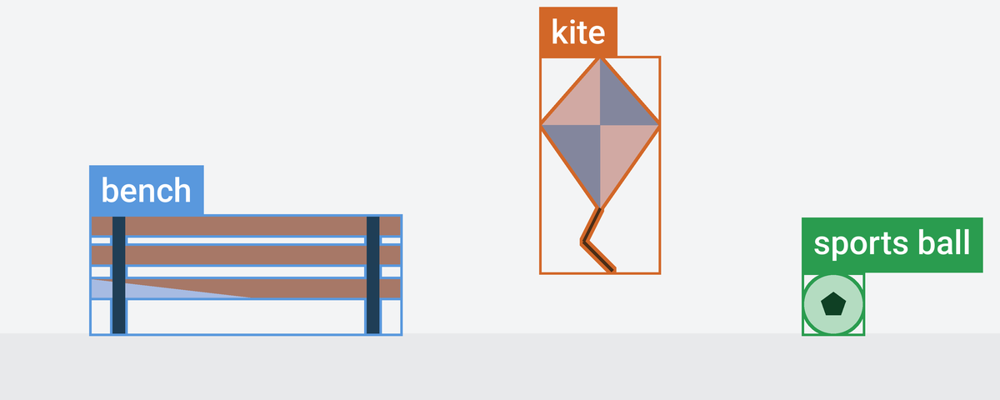

# RF-DETR Seg Medium

## Overview

RF-DETR Seg Medium finds everyday objects in an image and returns a box, a
class, a score, and a pixel mask for each. Use it to cut objects out of a scene
or measure their shape and area. It is trained on the COCO classes and predicts
each object once, so no overlapping boxes need removing. Your application picks
the 200 best candidate boxes on the CPU between the model's two parts.

## Inputs

One 432×432×3 (height, width, channel) RGB image, normalized with the ImageNet mean and standard deviation.

Preprocessing:

1. Stretch to 432×432 with bilinear resampling, without padding or cropping.
2. Divide by 255.
3. Subtract (0.485, 0.456, 0.406) and divide by (0.229, 0.224, 0.225), per channel.

## Between the components

The backbone returns `backbone_features`, `proposal_scores` (1,296 values), and `proposal_boxes` (1,296 rows of 4 values).

1. Take the 200 highest `proposal_scores`. Break ties by the lower index.
2. Gather those rows of `proposal_boxes` in that order as `proposals`, 200 rows of 4 values.
3. Run the decoder on `backbone_features` and `proposals`.

## Outputs

| Output | Size | Holds |
|---|---|---|
| `dets` | 200 rows of 4 values | boxes as (cx, cy, w, h), fractions of the image |
| `labels` | 200 rows of 91 values | class logits per box |
| `masks` | 108×108×200 (height, width, box) | mask logits per box |

Postprocessing:

1. Apply a sigmoid to `labels`.
2. Rank all 200×91 box-class pairs by that score and keep the 200 best.
3. Drop the pairs with an unused class index or a score below your threshold.
4. The box corners are (cx - w/2, cy - h/2) and (cx + w/2, cy + h/2).
5. Multiply x by the image width and y by the image height, and clip to the image.
6. Resize each kept pair's mask logits bilinearly to the image size. Pixels above zero belong to the object.

Class index i is COCO category ID i. Eleven of the 91 indexes are unused.

## Building applications

Run the package with the [Neat Model
API](https://developer.sima.ai/software/develop-apps/development-workflow/model).
For complete applications, start from the [Neat example
apps](https://developer.sima.ai/examples).
