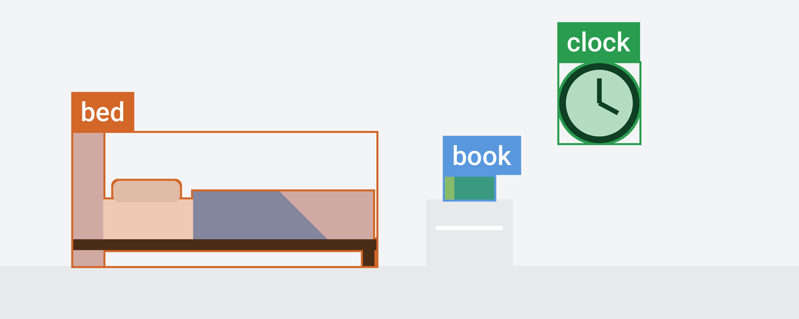

# RF-DETR Seg Nano

## Overview

RF-DETR Seg Nano is the Nano size of Roboflow's RF-DETR transformer instance
segmenter, trained on COCO. For each object it returns a box, class scores and a
pixel mask. It runs as two components: a backbone that proposes candidate boxes,
and a decoder that turns the best 100 candidates into 100 detections,
each with its mask. RF-DETR predicts each object once, so the application does
not need to remove overlapping boxes.

## Inputs and outputs

**Input.** Resize the image to 312×312 with bilinear resampling, without keeping
the aspect ratio. Scale the RGB values to 0–1, subtract the ImageNet mean
(0.485, 0.456, 0.406), and divide by the standard deviation (0.229, 0.224,
0.225). The reference scripts pass this image as a 312×312×3 (height, width,
channel) float tensor, with Neat's resize, color conversion, and normalization
turned off.

**Between the components.** The backbone returns `backbone_features`,
`proposal_scores`, and `proposal_boxes`, with 676 proposals. Take the 100
highest scores, breaking ties by the lower proposal index, and gather their
boxes in that order. Pass the gathered boxes as `proposals`, with
`backbone_features`, to the decoder. Keep this order, because the
decoder treats each position differently.

**Outputs.** The decoder returns `dets`, 100 boxes as normalized (cx, cy, w,
h), `labels`, 91 class logits for each box, and `masks`, a 78×78 grid of
mask logits for each box, laid out as height, width, box.

1. Apply a sigmoid to `labels` and rank all 100 × 91 box-class pairs by score.
2. Keep the 100 best pairs, then drop those with an unused class index.
3. Convert each box to corners: (cx - w/2, cy - h/2) and (cx + w/2, cy + h/2).
4. Multiply x by the image width and y by the image height, and clip to the image.
5. Resize each kept pair's mask logits bilinearly to the image; the pixels above zero belong to the object.

Class index i is COCO category ID i. Eleven of the 91 indexes are unused.

## Building applications

Run the package with the [Neat Model
API](https://developer.sima.ai/software/develop-apps/development-workflow/model).
For complete applications, start from the [Neat example
apps](https://developer.sima.ai/examples).
