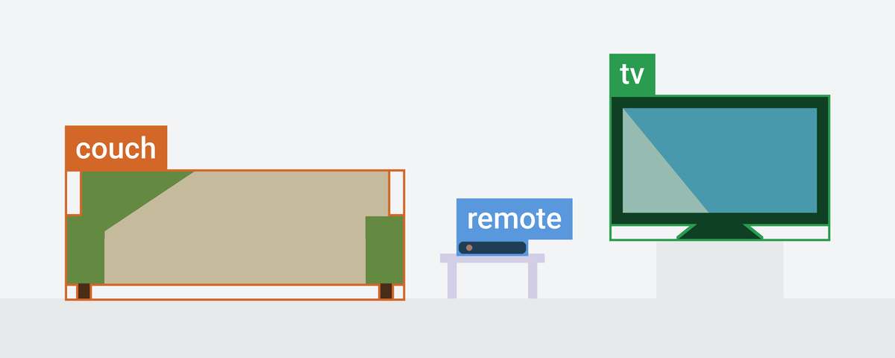

# RF-DETR Seg Small

## Overview

RF-DETR Seg Small finds everyday objects in an image and returns a box, a class,
a score, and a pixel mask for each. Use it to cut objects out of a scene or
measure their shape and area. It knows the COCO classes and predicts each object
once, so no overlapping boxes need removing. It is the Small size of Roboflow's
RF-DETR instance segmenter. The larger sizes are more accurate and slower. Your
application picks the 100 best candidate boxes on the CPU between the model's
two parts.

## Inputs and outputs

**Input.** One 384×384 RGB image, normalized with the ImageNet mean and standard deviation.

- With Neat: pass your frame as an image, with stretch resizing and the ImageNet normalization preset.
- Yourself: stretch to 384×384 with bilinear resampling. Scale to 0–1, subtract (0.485, 0.456, 0.406), divide by (0.229, 0.224, 0.225), and pass a 384×384×3 (height, width, channel) float tensor with Neat's preprocessing off.

**Between the components.** The backbone returns `backbone_features`, `proposal_scores`, and `proposal_boxes`, with 1,024 proposals.

1. Take the 100 highest scores, breaking ties by the lower proposal index.
2. Gather their boxes in that order and pass them as `proposals`, with `backbone_features`, to the decoder. Keep the order, because the decoder treats each position differently.

**Outputs.** Up to 100 detections, each a box, a class index, a score, and a mask. Neat has no decoder for this model, so decode these tensors.

| Tensor | Size | Holds |
|---|---|---|
| `dets` | 100 rows of 4 values | boxes as (cx, cy, w, h), fractions of the image |
| `labels` | 100 rows of 91 values | class logits per box |
| `masks` | 96×96×100 (height, width, box) | mask logits per box |

1. Apply a sigmoid to `labels` and rank all 100×91 box-class pairs by score.
2. Keep the 100 best pairs, then drop those with an unused class index.
3. The corners are (cx - w/2, cy - h/2) and (cx + w/2, cy + h/2). Multiply x by the image width and y by the image height, and clip to the image.
4. Resize each kept pair's mask logits bilinearly to the image size. The pixels above zero belong to the object.

Class index i is COCO category ID i. Eleven of the 91 indexes are unused.

## Building applications

Run the package with the [Neat Model
API](https://developer.sima.ai/software/develop-apps/development-workflow/model).
For complete applications, start from the [Neat example
apps](https://developer.sima.ai/examples).
