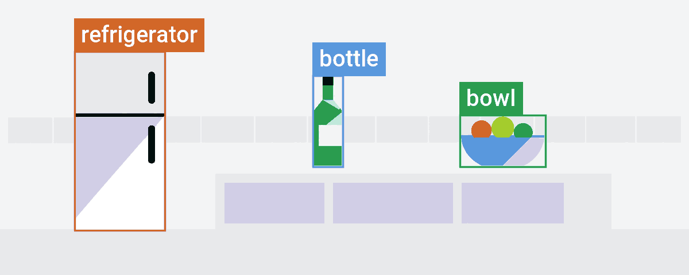

# RF-DETR Small

## Overview

RF-DETR Small is the Small size of Roboflow's RF-DETR transformer object
detector, trained on COCO. It runs as two components: a backbone that proposes
candidate boxes, and a transformer that turns the best 300 candidates into 300
detections. Your application selects those candidates on the CPU between the two
components. RF-DETR predicts each object once, so the application does not need
to remove overlapping boxes.

## Inputs and outputs

**Input.** Resize the image to 512×512 with bilinear resampling, without keeping
the aspect ratio. Scale the RGB values to 0–1, subtract the ImageNet mean
(0.485, 0.456, 0.406), and divide by the standard deviation (0.229, 0.224,
0.225). The reference scripts pass this image as a 512×512×3 (height, width,
channel) float tensor, with Neat's resize, color conversion, and normalization
turned off.

**Between the components.** The backbone returns `backbone_features`,
`proposal_scores`, and `proposal_boxes`, with 1,024 proposals. Take the 300
highest scores, breaking ties by the lower proposal index, and gather their
boxes in that order. Pass the gathered boxes as `proposals`, with
`backbone_features`, to the transformer. Keep this order, because the
transformer treats each of the 300 positions differently.

**Outputs.** The transformer returns `dets`, 300 boxes as normalized (cx, cy, w,
h), and `labels`, 91 class logits for each box.

1. Apply a sigmoid to `labels` and rank all 300 × 91 box-class pairs by score.
2. Keep the 300 best pairs, then drop those with an unused class index.
3. Convert each box to corners: (cx - w/2, cy - h/2) and (cx + w/2, cy + h/2).
4. Multiply x by the image width and y by the image height, and clip to the image.

Class index i is COCO category ID i. Eleven of the 91 indexes are unused.

## Building applications

Run the package with the [Neat Model
API](https://developer.sima.ai/software/develop-apps/development-workflow/model).
For complete applications, start from the [Neat example
apps](https://developer.sima.ai/examples).
