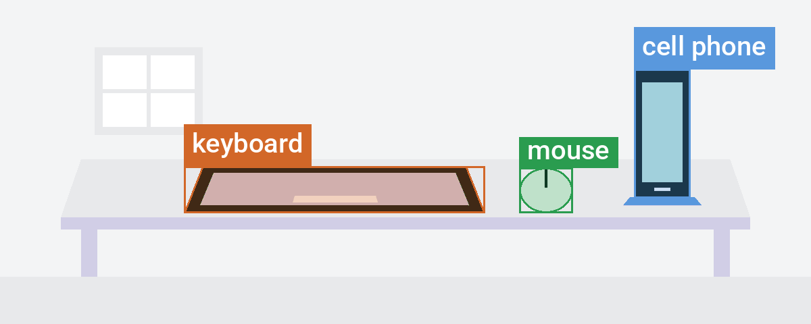

# RTMDet-Ins S

## Overview

RTMDet-Ins S finds everyday objects in an image and returns a box, a class, a
score, and a pixel mask outlining each one. Use it to cut
objects out, measure their area, or blur them. It is trained
on the 80 object classes of the COCO dataset. Your application builds each mask on the
CPU from weights predicted for that object.

## Inputs

One 640×640×3 (height, width, channel) RGB image, normalized with the ImageNet mean and standard deviation.

Preprocessing:

1. Resize bilinearly by min(640 / width, 640 / height), rounding each side to whole pixels.
2. Place the image at the top left of a 640×640 gray (114, 114, 114) frame.
3. Subtract (123.675, 116.28, 103.53) from the RGB values and divide by (58.395, 57.12, 57.375).

## Outputs

| Output | Grid | Per cell |
|---|---|---|
| `cls_score_0` to `cls_score_2` | 80×80, 40×40, 20×20 (stride 8, 16, 32) | 80 class logits |
| `bbox_pred_0` to `bbox_pred_2` | same | distances in pixels from the cell's point to the left, top, right, and bottom box edges |
| `kernel_pred_0` to `kernel_pred_2` | same | 169 mask weights |
| `mask_feat` | 80×80 (stride 8) | 8 mask features |

Postprocessing:

1. Cell (c, r) at stride s has its point at (c × s, r × s).
2. Apply a sigmoid to the class logits. Per grid, keep the 1000 best cell-class pairs scoring above 0.05.
3. The box is the point minus the left and top distances and plus the right and bottom ones, clipped to the resized image.
4. Within each class, drop boxes overlapping a better box by more than 0.6. Keep the best 100.
5. For each `mask_feat` cell, form 10 values: the detection's point minus the cell's point (x, y), divided by 8 × the detection's stride, then the 8 mask features.
6. Split the detection's 169 weights in order into row-major matrices of 8×10, 8×8, and 1×8, and biases of 8, 8, and 1.
7. Apply each matrix and bias in turn, zeroing negatives after the first two, for one mask logit per cell.
8. Resize the logits bilinearly to 640×640, then by the inverse resize scale, rounded up. Crop the top left to the image; missed pixels are background. Positive pixels are the mask.
9. Divide the boxes by the resize scale.

Class index i is the i-th COCO category ID in ascending order.

## Building applications

Run the package with the [Neat Model API](https://developer.sima.ai/software/develop-apps/development-workflow/model).
For complete applications, start from the [Neat example apps](https://developer.sima.ai/examples).
